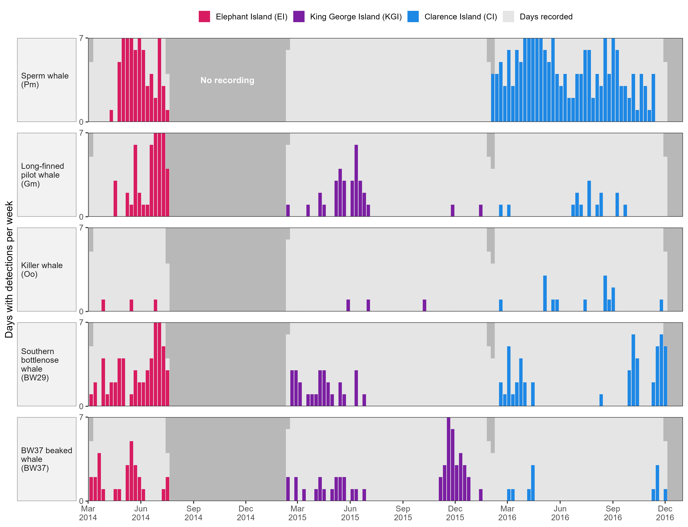
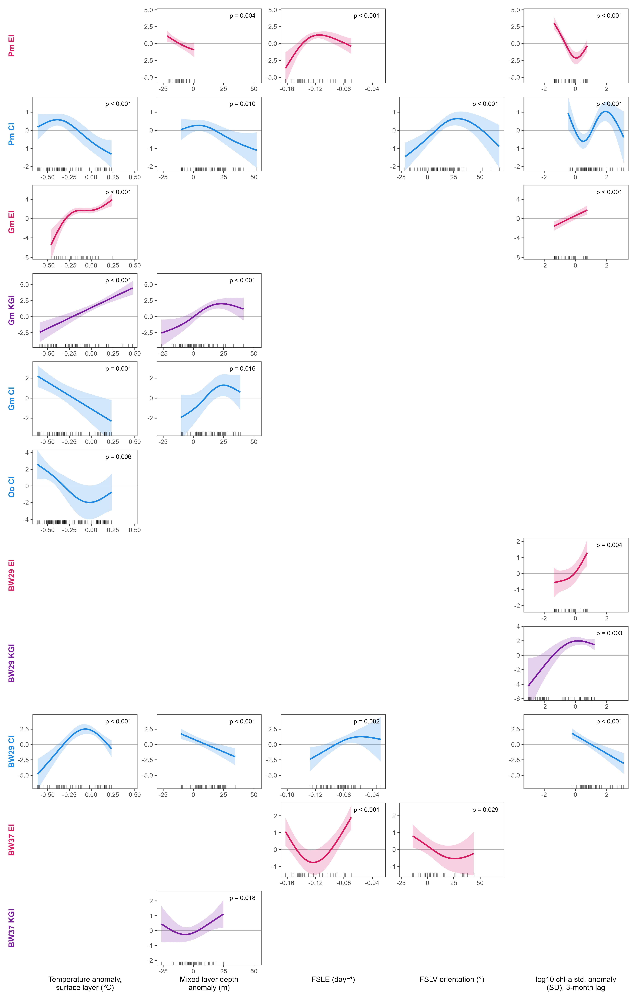
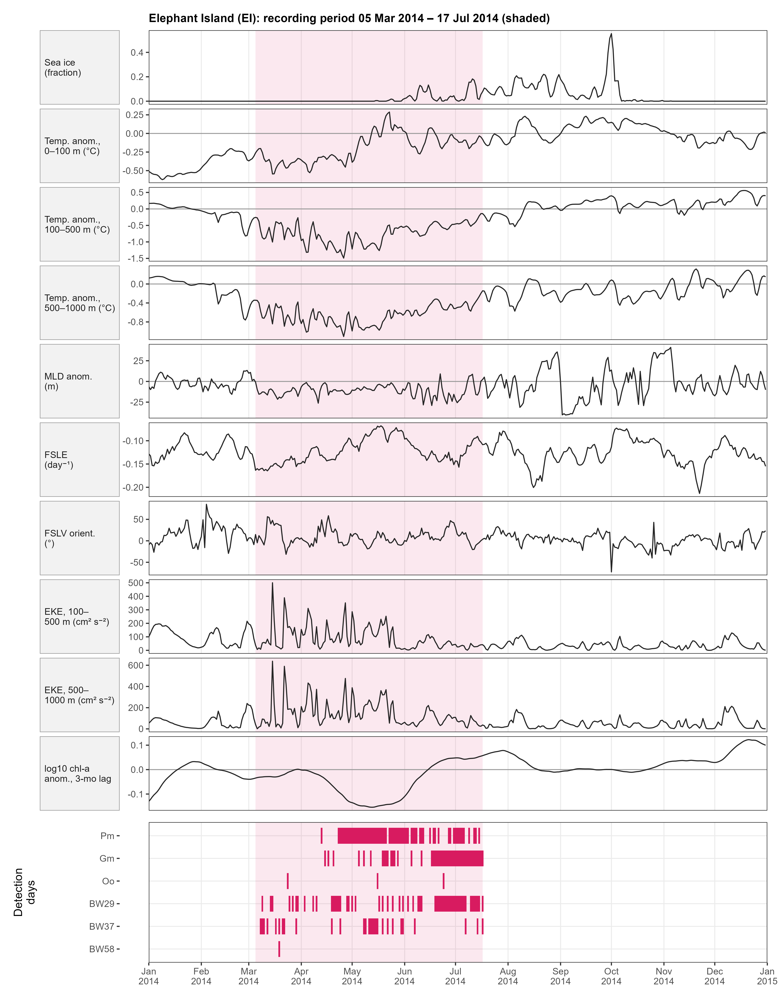
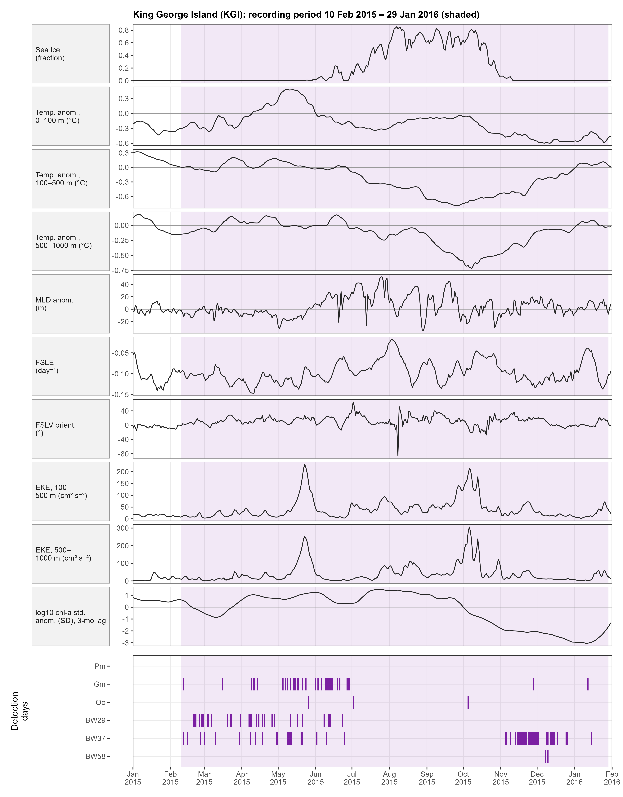
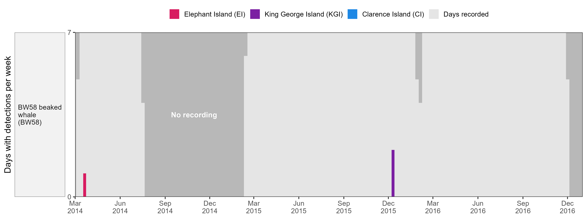

<!--
Working draft of the odontocete manuscript. Inline R numbers and all
tables built in R chunks are read from final_scripts_odontocetes/outputs/ by
_values.R, so they update when the analysis is re-run. Figures are read
directly from outputs/. Typed numbers (site positions, deployment dates,
profile counts, layer boundaries, duty-cycle results in the text) are static.
Render: quarto render manuscript.qmd   (or the Render button in VS Code)
Flags in red: \ins{} = to add; \conf{} = to verify. References are plain text
for now; convert to a .bib file at the end.
-->

```{r}
#| label: setup
source("_values.R")
```

# Abstract {.unnumbered}

Toothed whales are the most diverse group of top predators in the Southern Ocean, yet where and when they occur in Antarctic waters, particularly in winter, remains poorly known. Many of these species forage hundreds of metres below the surface, where Antarctic Circumpolar Current, Bellingshausen Sea and Weddell Sea waters meet around the Antarctic Peninsula. Habitat studies, however, have relied mostly on surface conditions and on summer ship-based surveys. How odontocete occurrence relates to sea ice and to conditions at foraging depth has therefore not been tested. Here we show, using year-round passive acoustic recordings at three sites in the South Shetland Islands (2014--2016), that sea ice and anomalous ocean conditions at the surface and at depth structure odontocete occurrence. `r tools::toTitleCase(and_list(SP_TEXT[heavy_ice_species]))` were detected under more than 50% sea-ice cover, whereas long-finned pilot whales were never detected above `r ceiling(cutoff[["Gm"]])`% cover and two beaked whale signal types (BW29 and BW37) never above `r ceiling(cutoff[["BW29"]])`%. After the seasonal cycle was removed, warmer-than-usual surface water was associated with pilot whale presence at all three sites. Beaked whale and sperm whale presence was linked to surface fronts, and to mid-water eddy activity and deep-layer temperature anomalies, depending on site. Responses differed among sites that sample distinct water masses, indicating that habitat associations are local rather than species-wide. As sea ice retreats and warm Circumpolar Deep Water increasingly reaches the Antarctic Peninsula shelf, subsurface conditions may shape odontocete distribution as much as surface conditions do. Ocean reanalyses validated against in-situ profiles offer a way to include them in habitat models. \conf{wording of the habitat sentences after the final run}

# Introduction

\ins{Introduction to be written}

# Methods

## Study area {#sec-study}

Passive acoustic data were collected at three sites along the northern shelf slope of the South Shetland Islands, Antarctica: Elephant Island (EI; 60°53.214′S, 55°57.238′W; 762 m depth), King George Island (KGI; 61°27.469′S, 57°56.515′W; 768 m), and Clarence Island (CI; 61°15.112′S, 53°29.006′W; 1033 m) (@fig-map).

The South Shetland Islands lie at the confluence of water masses from the Drake Passage, the Bellingshausen Sea, and the Weddell Sea (@fig-map). To the north, the Southern Antarctic Circumpolar Current Front and the Southern Boundary of the Antarctic Circumpolar Current (ACC) follow the continental slope (Orsi et al. 1995), and the Southern Boundary passes close to the EI and KGI sites. Upper Circumpolar Deep Water from the ACC intrudes onto the northern South Shetland shelf as modified Circumpolar Deep Water (mCDW), particularly west of the Shackleton Transverse Ridge, whereas shelf waters are exported offshore north of Elephant Island, just downstream of the EI site (Zhou et al. 2013, Damini et al. 2025). South of the islands, the Bransfield Current flows northeastward along the southern slope of the South Shetland Islands, carrying relatively warm and fresh Transitional Zonal Water with Bellingshausen Sea influence (TBW; Sangrà et al. 2011, 2017, Veny et al. 2022), with part of the flow recirculating southwestward along the northern side of the islands (Dotto et al. 2021, Damini et al. 2025). Colder and saltier Transitional Zonal Water with Weddell Sea influence (TWW) enters Bransfield Strait from the east via the Antarctic Coastal Current and the Antarctic Slope Front around the tip of the Antarctic Peninsula (Heywood et al. 2004, Thompson et al. 2009) and is separated from TBW by the Peninsula Front (Sangrà et al. 2011, Veny et al. 2024). East of Elephant Island, the Antarctic Slope Front bifurcates over the South Scotia Ridge near the CI site, forming a westward branch and a quasi-stationary eddy (Thompson et al. 2009). The three sites therefore sample contrasting oceanographic regimes: EI near the shelf-water export pathway at the Shackleton Gap, KGI on the northern South Shetland slope beneath the Southern Boundary of the ACC, and CI under stronger Weddell Sea influence \conf{characterization of each site}.

High-frequency Acoustic Recording Packages (HARPs; Wiggins & Hildebrand 2007) were deployed sequentially at the three sites, sampling at 200 kHz. Recordings spanned 5 March -- 17 July 2014 at EI (134.5 days), 10 February 2015 -- 29 January 2016 at KGI (353.6 days), and 3 February -- 2 December 2016 at CI (302.2 days) (Table \ref{tab:deploy}). The EI and KGI recorders were duty-cycled (5 min on every 6 min and 10 min on every 13.33 min, respectively), whereas the CI recorder recorded continuously.

Bathymetry for the study-area map (@fig-map) was obtained from the Global Multi-Resolution Topography synthesis (GMRT v4.4.1; Ryan et al. 2009; accessed 11 May 2026 via GMRT MapTool) and contoured at 500-m intervals. Regional circulation (@fig-map) was illustrated with long-term (2009--2021) mean surface currents from the Copernicus Marine Service global ocean physics reanalysis (GLOBAL_MULTIYEAR_PHY_001_030, dataset version 202311, monthly means at 0.5 m; accessed 17 November 2026) and the positions of the Southern Antarctic Circumpolar Current Front and the Southern Boundary of the Antarctic Circumpolar Current from Orsi et al. (1995).

```{r}
#| label: deploy
data.frame(
  Site = SITES, Latitude = c("60°53.214′S", "61°27.469′S", "61°15.112′S"),
  Longitude = c("55°57.238′W", "57°56.515′W", "53°29.006′W"),
  `Depth (m)` = c(762, 768, 1033),
  `Start (UTC)` = c("2014-03-05 00:00", "2015-02-10 00:00", "2016-02-03 23:59"),
  `End (UTC)` = c("2014-07-17 12:03", "2016-01-29 13:15", "2016-12-02 05:15"),
  `Duration (d)` = c(134.5, 353.6, 302.2),
  `Duty cycle` = c("5 of 6 min", "10 of 13.33 min", "Continuous"), check.names = FALSE) |>
  latex_table("HARP deployments.", size = 9)
```

![Study area and regional circulation around the South Shetland Islands, Antarctica. Circles mark the High-frequency Acoustic Recording Package (HARP) sites at Elephant Island (EI; 2014), King George Island (KGI; 2015--2016), and Clarence Island (CI; 2016), shown on GMRT bathymetry (v4.4.1; Ryan et al. 2009) with 500-m isobaths. Black arrows show mean surface currents for 2009--2021 from the Copernicus Marine Service global ocean physics reanalysis (GLORYS12V1). Black dashed and dot-dashed lines mark the Southern Antarctic Circumpolar Current Front (SACCF) and the Southern Boundary of the Antarctic Circumpolar Current (SB), respectively (Orsi et al. 1995). Colored lines show schematic pathways digitized from Damini et al. (2025): intrusion of modified Circumpolar Deep Water (mCDW); the Bransfield Current (BC), carrying Transitional Zonal Water with Bellingshausen Sea influence (TBW), and its recirculation; the Antarctic Coastal Current (ACoC), carrying Transitional Zonal Water with Weddell Sea influence (TWW); the Antarctic Slope Front (ASF) and associated eddy; and the Peninsula Front (PenF). The inset shows the location of the study area (red box) relative to the Antarctic Peninsula and South America.](../outputs/01_study_area/study_area_currents_map_schematic.png){#fig-map width=100%}

## Water-column structure {#sec-water}

To describe the water column at each site, daily potential temperature and practical salinity were taken from the Copernicus Marine Service global ocean physics reanalysis (GLOBAL_MULTIYEAR_PHY_001_030, dataset version 202311; 1/12°, daily means), and daily dissolved oxygen was taken from the companion global biogeochemistry hindcast (GLOBAL_MULTIYEAR_BGC_001_029, dataset version 202406; 1/4°, daily means), both accessed 17--18 November 2026 (@sec-env). Each variable was averaged over all ocean grid cells within a ±20 km box centered on each site, at every model level from the surface (0.5 m) to 1000 m. Because the shelf slope runs through each box, only part of the box reaches the deeper levels, so deep means represent only the cells deep enough to contain those levels. Oxygen was unavailable below the deepest water in the coarser biogeochemistry box (773 m at KGI, 1046 m at CI).

We divided the upper 1000 m into three layers, used both to describe the water column and to define the habitat predictors (@sec-stats): a surface layer (0--100 m), a mid-water layer (100--500 m), and a deep layer (500--1000 m). The boundaries were derived from the reanalysis using depth-constrained clustering of temperature--salinity anomalies and water-mass features of the mean profiles (Supplement S1; @fig-layers).

Daily profiles were linearly interpolated onto a regular grid in the square root of depth (300 levels, no extrapolation) and displayed as one continuous depth--time section from January 2014 to December 2016 (@fig-sections). Each period used the box of the site that was recording, or about to record, in that period: EI for 2014, KGI for January 2015 -- January 2016, and CI for February -- December 2016. Sea-ice concentration from the same reanalysis and box (@sec-ice) was shown above the sections. Layer-mean temperature, salinity, oxygen and eddy kinetic energy were summarized as the mean ± SD over each site's recording period (Table S\ins{INSERT}). Temperature--salinity diagrams for each site's recording period were plotted with contours of potential density anomaly ($\sigma_\theta$) calculated at zero pressure using the UNESCO EOS-80 equation of state (oce R package 1.8-3; Kelley & Richards 2024) (@fig-ts).

![Daily water-column conditions from January 2014 to December 2016 in the upper 1000 m. The record is assembled from the ±20 km box around EI (2014), KGI (January 2015 -- January 2016), and CI (February -- December 2016). Thin vertical black lines mark where the source site changes, and colored outlines mark each site's recording period. Top: sea-ice concentration (%). Lower panels: potential temperature (°C), salinity, and dissolved oxygen (mmol m$^{-3}$) from the Copernicus Marine Service global physics reanalysis (temperature, salinity; 1/12°) and biogeochemistry hindcast (oxygen; 1/4°), plotted on a square-root depth axis with white contours (0.5 °C, 0.1, and 20 mmol m$^{-3}$, respectively). Dashed lines mark the boundaries of the surface (0--100 m), mid-water (100--500 m) and deep (500--1000 m) layers; right-hand labels give the species whose foraging depths fall in each layer (Pm, sperm whale; Gm, long-finned pilot whale; Oo, killer whale; BW29, southern bottlenose whale; BW37, BW37 beaked whale). Grey areas mark depths with no model water in the box; at KGI, oxygen is unavailable below 773 m, so the deep-layer oxygen mean there covers 500--773 m.](../outputs/02_deep_oceanography/ts_sections.png){#fig-sections width=100%}

## Sea ice {#sec-ice}

Daily sea-ice concentration was obtained from the Copernicus Marine Service global ocean physics reanalysis (GLOBAL_MULTIYEAR_PHY_001_030, dataset version 202311; 1/12° horizontal resolution; accessed 17--18 November 2026) and averaged over a box extending ±20 km from each HARP (approximately 40 × 40 km). The product reports open-water ocean cells as missing rather than zero. These cells were therefore set to zero before averaging, so the daily box mean is the fraction of the whole box covered by ice, not the mean concentration of the ice-covered cells only.

Acoustic occurrence was first described across sea-ice conditions as the percentage of time bins with detections in four sea-ice concentration classes (0--5, 5--15, 15--50 and >50%; @fig-iceocc). Sea ice was then used in two ways in the models. First, for each species and site, acoustic presence was modeled against sea-ice concentration using all recording bins (@sec-stats), to describe how occurrence varied with the seasonal advance and retreat of the ice. Second, the habitat models (@sec-stats) were meant to test the influence of other environmental conditions only when each species could plausibly be present. They were therefore restricted, for each species, to time bins whose mean sea-ice concentration was no greater than the highest bin-mean concentration at which that species was detected, pooled across sites. The cutoffs were `r f1(cutoff[["Oo"]])`% for killer whales, `r f1(cutoff[["Pm"]])`% for sperm whales, `r f1(cutoff[["Gm"]])`% for long-finned pilot whales, and `r f1(cutoff[["BW29"]])`% for southern bottlenose whales and `r f1(cutoff[["BW37"]])`% for BW37 beaked whales (Table \ref{tab:icecut}). By construction, no bins with detections were excluded. The restriction removed no bins at EI. It removed `r removed("Oo", "CI")` two-day bins for killer whales at CI, `r removed("Gm", "CI")` (CI) and `r removed("Gm", "KGI")` (KGI) four-day bins for long-finned pilot whales, and `r removed("BW29", "CI")` (CI) and `r removed("BW29", "KGI")` (KGI) four-day bins for each beaked whale. Sea-ice concentration was therefore not a candidate predictor in the habitat models.

## Acoustic detection {#sec-detect}

For beaked whales, sperm whales (*Physeter macrocephalus*), and long-finned pilot whales (*Globicephala melas*), echolocation signals were first detected with an expert system using a two-step approach (Roch et al. 2011) and then verified by an expert analyst. For beaked whales at EI, a previously published dataset of echolocation signals was used (Baumann-Pickering et al. 2015); the same data processing methods were replicated for beaked whales at KGI and CI, and for sperm whale and long-finned pilot whale signals at all sites. Killer whale (*Orcinus orca*) signals were identified by an expert analyst through manual review of long-term spectral averages (LTSAs) \conf{method and LTSA settings}. Beaked whale echolocation pulses were classified into southern bottlenose whale (*Hyperoodon planifrons*; BW29) and the BW37 and BW58 signal types. Previous work has hypothesized that the BW37 and BW58 echolocation pulses could be produced by Gray's (*Mesoplodon grayi*) and strap-toothed (*M. layardii*) beaked whales, respectively (Trickey et al. 2015, Baumann-Pickering et al. 2015, Barlow et al. 2021); Shepherd's beaked whale (*Tasmacetus shepherdi*) has also been proposed as a candidate for these unidentified signals (Barlow et al. 2021). Further research is still needed to confirm the species producing these echolocation pulses.

Only echolocation clicks were used to define presence; sperm whale slow clicks (n = 44 events) and killer whale high-frequency modulated signals (n = 3 events) were excluded. Verified detections were summarized into 5-min bins, and a bin was considered positive for a species if any detection overlapped it. Daily acoustic presence was quantified as the number of minutes in positive bins per day (positive bins × 5 min). Daily recording effort was calculated as the time within each deployment's recording period, accounting for partial first and last days and for the duty cycle at EI and KGI.

To assess whether duty cycling reduced detectability, the continuously recorded CI data were subsampled to the EI (5 min on every 6 min) and KGI (10 min on every 13.33 min) duty cycles at 100 random phase offsets, and the proportion of detection events, positive 5-min bins, and presence days retained was calculated for each species (Table \ref{tab:duty}; @fig-duty). Subsampling retained ≥ 89.6% of positive 5-min bins and ≥ 89.6% of presence days on average for all species under either duty cycle (lowest: sperm whales under the KGI duty cycle; ≥ 96.5% of presence days for all other species), despite recording only 83.3% (EI) and 75.0% (KGI) of the time. Because losses were far smaller than proportional to recording time, presence was not scaled by recording effort.

## Environmental data {#sec-env}

Environmental conditions at each site were characterized with daily output from the Copernicus Marine Service global ocean physics reanalysis (GLOBAL_MULTIYEAR_PHY_001_030, GLORYS12V1, dataset version 202311; 1/12° horizontal resolution, 50 vertical levels) and global biogeochemistry hindcast (GLOBAL_MULTIYEAR_BGC_001_029, dataset version 202406; 1/4° resolution), both accessed 17--18 November 2026 \ins{REF product DOIs}. From the physics reanalysis, we used potential temperature, zonal and meridional velocity, mixed layer depth, and sea-ice concentration (@sec-ice). Mixed layer depth is defined in this product as the depth at which density exceeds its value at 10 m by the amount equivalent to a 0.2 °C temperature decrease under local surface conditions. From the biogeochemistry hindcast, we used chlorophyll-*a*. Following \ins{COMPANION PAPER}, fronts and surface mesoscale stirring were described with backward-in-time finite-size Lyapunov exponents (FSLEs) and the orientations of the associated finite-size Lyapunov vectors (FSLVs) (d'Ovidio et al. 2004), from the AVISO+ FSLE product computed from DUACS delayed-time multi-satellite absolute geostrophic velocities (version DT2024; 1/25°, daily; accessed 17--18 November 2026) \ins{REF AVISO+}.

Each variable was averaged daily over all ocean grid cells within ±20 km of each recorder (approximately 40 × 40 km). This area is larger than the distances over which the target species' echolocation clicks can be detected by a HARP: up to about 4 km for beaked whales (Zimmer et al. 2008, Hildebrand et al. 2015), \ins{range, with reference} for killer whales and long-finned pilot whales, and up to about 20 km for sperm whales, which at these latitudes are adult males \ins{REF}. It therefore includes the water around any detected animal. The box was also large enough to contain several grid cells of the coarser 1/4° biogeochemistry product (one cell spans ~28 km in latitude), whereas a ±10 km box would contain at most one. The ±20 km box contained 32--45 physics cells (EI 32, KGI 36, CI 45) and 3--6 biogeochemistry cells (EI 6, KGI 3, CI 3) at the surface.

Water-column variables were averaged over the three depth layers: surface (0--100 m), mid-water (100--500 m), and deep (500--1000 m). Each layer mean was weighted by thickness: each model level represents the depth interval between the midpoints to its neighbouring levels, and its weight is the overlap of that interval with the layer. Only grid cells with water at a level contributed, so deep-layer means represent the parts of the box deep enough to reach them. Eddy kinetic energy (EKE) was calculated at each model level as $\frac{1}{2}(u'^2 + v'^2)$, where $u'$ and $v'$ are the daily box-mean velocity components minus their 10-year means at that site and level, and then averaged over the mid-water and deep layers in the same way. Because a box mean over fewer grid cells averages out less of the eddy variability, absolute EKE values are not directly comparable between layers or sites (e.g., at EI, deep-layer EKE exceeded surface EKE); within a site and layer, its variation over time is comparable.

Mean FSLE included grid cells with an FSLE of zero, where the particle-separation threshold was not reached within the integration time; these zeros are valid values, not missing data. FSLV orientation is axial (orientations 180° apart describe the same front), so it was averaged by doubling the angles, taking the circular mean, and halving the result, using only the cells with nonzero FSLE (on average 87--95% of the box per day). To represent the delayed response of odontocete prey to phytoplankton production, surface chlorophyll-*a* was averaged over the 30-day window ending 3 months before each day.

All variables were extracted for each site's deployment years ± 5 years (EI 2009--2019, KGI 2010--2021, CI 2011--2021). This 10-year record provided the climatologies used to deseason predictors (@sec-stats) and the reference mean flow for EKE, and it allowed lagged chlorophyll-*a* to be calculated for the first months of each deployment. No predictor had missing values on any recording day.

### Model comparison and validation {#sec-valid}

To assess how much the water-column predictors depended on the choice of ocean model, and how well they reproduced observations, the Copernicus reanalysis was compared with an independent ocean model and with satellite and in-situ observations. HYCOM GOFS 3.1 (GLBv0.08; 1/12° × 1/25°, 40 depth levels) \ins{REF} daily temperature and salinity were obtained for each site's recording period, using the 3-hourly time step closest to 12:00 UTC. No single HYCOM experiment spans 2014--2016, so the reanalysis (experiment 53.X) was used for 2014 and the analysis experiments 56.3 and 57.2 thereafter. Daily sea surface temperature from the Aqua MODIS sensor (4 km, daytime, quality-masked; NOAA CoastWatch ERDDAP dataset erdMH1sstd1dayR20190SQ) \ins{REF} was used where at least 20% of the box's ocean pixels were valid. All products were averaged over the same ±20 km box around each site and matched by date. HYCOM was interpolated to the Copernicus model levels, and agreement was summarized as the mean difference (bias), root-mean-square error (RMSE) and Pearson correlation ($r$), for raw values and for anomalies from each product's monthly means over the matched days (@fig-hycom).

Both models were also compared with in-situ profiles from the World Ocean Database \ins{REF} in a wider region around the sites (60--63°S, 52--60°W) from 2014 to 2016: 915 profiles from instrumented seals, Argo floats, ship CTDs, bottle casts and expendable bathythermographs (@fig-insitu a). Only observations and profiles that passed the World Ocean Database quality control were used. For each profile, both models were sampled at the nearest grid cell with water on the profile's day (Copernicus daily mean; HYCOM time step nearest the profile time). Observed profiles were interpolated to the Copernicus model levels within their measured depth range, and oxygen was converted from µmol kg$^{-1}$ to mmol m$^{-3}$ using in-situ density. Bias, RMSE and $r$ were computed at each level and for thickness-weighted means of the three depth layers, using only profiles covering at least 80% of a layer and only profile--level combinations available in both models. Because both models assimilate some in-situ profiles (e.g., Argo), this comparison is not fully independent.

## Statistical analyses {#sec-stats}

Relationships between odontocete acoustic presence and environmental conditions were modeled with generalized additive models (GAMs), consistent with the methods described for baleen whales in \ins{COMPANION PAPER}. Separate models were fit for each species at each site. To reduce temporal autocorrelation, daily presence was aggregated into consecutive multi-day bins. For each species and site, a GAM of daily presence minutes on a smooth of days since the start of recording was fit, and the bin length was the first lag at which the autocorrelation of its residuals fell within the 95% confidence bounds. For comparability across sites, each species was assigned the longest bin length among its sites, capped at 4 days to retain at least 30 bins at the shortest deployment (EI, 135 days). Bins were 4 days long for all species except killer whales (2 days); the cap applied to `r capped_phrase`, whose residual autocorrelation lasted `r capped_lags` days, respectively. The response was the mean daily presence minutes within each bin. Species--site combinations with fewer than 10 bins containing detections were not modeled and are described only in @sec-occ (`r combo_phrase(not_modeled)`). Models with 10--20 bins with detections (`r combo_phrase(low_sample)`) were identified as low-sample models.

Two types of model were fit. Sea-ice models related presence to sea-ice concentration alone, using all bins, and describe the seasonal pattern of occurrence; because their residuals were strongly autocorrelated, they are reported in the supplement, and occurrence across sea-ice classes is presented descriptively in the main text (@sec-ice). Habitat models related presence to the remaining environmental predictors, using only bins with sea-ice concentration no greater than the highest concentration at which the species was detected (@sec-ice). Because the seasonal pattern is described by the sea-ice models, the habitat models were designed to test responses to conditions that were unusual for the time of year. All habitat predictors with a seasonal cycle were therefore expressed as anomalies from a 10-year climatology (deployment years ± 5 years): the 12 monthly means were interpolated to daily values with a periodic cubic spline and subtracted from the daily values. EKE, FSLE and FSLV orientation have almost no seasonal cycle (the seasonal cycle explained ≤ 8% of their daily variance at every site) and were used as raw values.

Each candidate habitat predictor represents a different process (Table \ref{tab:pred}). Water-column conditions were represented by the temperature anomaly of each depth layer the species uses: the surface layer (0--100 m) for all species, plus the mid-water layer (100--500 m) for sperm and killer whales and the deep layer (500--1000 m) for sperm whales, long-finned pilot whales, southern bottlenose whales and BW37, according to their foraging depths (Table S\ins{INSERT}). Temperature was the only water-mass variable because, of the variables available, it was the one the reanalysis reproduced well in all three layers when compared with in-situ profiles (@sec-valid; $r$ = `r r_T_range` for layer means, versus `r r_S_mid_cop` for mid-water salinity and ≤ `r r_O2_max` for oxygen). Eddy activity was represented by EKE in the mid-water and deep layers used by each species, and surface fronts by FSLE and FSLV orientation. Stratification was represented by the mixed layer depth anomaly. Productivity was represented by the anomaly of log$_{10}$-transformed surface chlorophyll-*a* averaged over the 30-day window ending 3 months before each day. A single lag was used for all species: among the candidate lags, the 3-month lag was the most consistently associated with presence in exploratory single-term models (significant in 9 of 11 species--site models, versus 6 of 11 for a 5-month lag).

All models used a Tweedie distribution with a log link (power parameter estimated between 1.1 and 1.9), smoothing parameters estimated by restricted maximum likelihood (REML), and thin-plate regression splines with a basis dimension of 4. FSLV orientation was fit with a cyclic cubic spline joined at ±90°, because orientations differing by 180° are equivalent (Haller 2015). For each species and site, the candidates were screened for collinearity by sequentially removing the predictor with the highest variance inflation factor (VIF) until all were ≤ 5 (Zuur et al. 2010), and terms were then removed by backward selection, using additional shrinkage of smooth terms (`select = TRUE`), until all remaining terms were significant ($p$ ≤ 0.05). To limit overfitting, the number of smooth terms was restricted following the guideline of at least 10 observations per estimated term (Peduzzi et al. 1996, Harrell 2015) \conf{references}. Each model was allowed at most one term per 10 bins; in low-sample models (10--20 bins with detections), where the bins with detections rather than all bins carry most of the information, at most two terms were allowed (i.e., about one term per 10 bins with detections). The limit was applied during backward selection: once all remaining terms were significant, the least significant term continued to be removed until the model met the limit. With shrinkage, smooth terms in the final models had a median of `r edf_median` effective degrees of freedom (range `r edf_min`--`r edf_max`). A common set of predictors was then chosen for each species (the predictors selected at any of its sites), and the final model at each site was refit from this set with the same backward selection.

Model fit was assessed with residual diagnostics, basis-dimension checks and concurvity (Table \ref{tab:diagnostics}). Residual autocorrelation was tested with a Ljung--Box test over lags 1--5 bins, computed on the bin series with bins removed by the ice filter treated as gaps. As a sensitivity analysis, each final model was refit with an additional first-order autoregressive (AR(1)) process in glmmTMB (Brooks et al. 2017), keeping the same smooth terms (FSLV orientation as $\sin 2\theta$ and $\cos 2\theta$). AR(1) was retained where it lowered AIC by more than 2, and each term was then tested by a likelihood-ratio test (Supplement S5). Analyses were conducted in R 4.5.1 (R Core Team 2025) with the packages mgcv `r packageVersion("mgcv")` (Wood 2017), car `r packageVersion("car")` (Fox & Weisberg 2019), gratia `r packageVersion("gratia")` (Simpson 2024) and glmmTMB `r packageVersion("glmmTMB")` (Brooks et al. 2017).

```{r}
#| label: pred
data.frame(
  Predictor = c("Potential temperature", "FSLE (backward-in-time)", "FSLV orientation (cyclic)",
                "EKE, ½(u′² + v′²)", "Mixed layer depth",
                "log10 chlorophyll-a, 30-day mean ending 3 months earlier"),
  Represents = c("Water mass", "Surface fronts and stirring", "Orientation of surface fronts",
                 "Eddy activity at foraging depth", "Stratification", "Delayed productivity (prey)"),
  Layer = c("Mean of each layer used", "Surface", "Surface", "Mid-water and/or deep", "Surface", "Surface"),
  Units = c("°C", "day⁻¹", "°", "cm² s⁻²", "m", "log10 mg m⁻³"),
  Form = c("Anomaly", "Raw", "Raw", "Raw", "Anomaly", "Anomaly"),
  Source = c("Copernicus PHY", "AVISO+", "AVISO+", "Copernicus PHY", "Copernicus PHY", "Copernicus BGC")) |>
  latex_table(paste("Candidate predictors for the habitat models. Layers: surface 0--100 m (all species);",
                    "mid-water 100--500 m (sperm whale, killer whale); deep 500--1000 m (sperm whale,",
                    "long-finned pilot whale, southern bottlenose whale, BW37). Sea-ice concentration",
                    "(Copernicus PHY) was used only in the sea-ice models and for the ice cutoff."),
              widths = c("3.3cm", "3.4cm", "2.6cm", "1.8cm", "1.3cm", "2cm"), size = 9)
```

# Results

## Acoustic occurrence {#sec-occ}

\ins{Occurrence text to be written (@fig-weekly; detection days per species and site)}

Occurrence differed strongly across sea-ice conditions (@fig-iceocc). \ins{Text to be written}

Three species--site combinations had too few detections to model (killer whales at EI and KGI, 3 detection days each; BW37 at CI, 11 days; Table \ref{tab:rare}). Killer whale detections at KGI coincided with high eddy kinetic energy in the mid-water and deep layers (94th--97th percentile of recording days), and one of the three detections occurred under 70% sea-ice cover. BW37 at CI was detected only in ice-free periods (March--April and November), on days with above-typical deep-layer eddy kinetic energy (83rd percentile).

{#fig-weekly width=100%}

{#fig-iceocc width=100%}

## Choice of ocean model

The Copernicus reanalysis agreed with the independent observations at least as well as HYCOM did, and it was used for all predictors. Against MODIS surface temperature, Copernicus had smaller warm biases than HYCOM at all sites (`r modis_bias("Copernicus")` °C vs `r modis_bias("HYCOM")` °C; @fig-hycom a). At depth, the two models differed by a near-constant offset, with HYCOM up to ~1 °C warmer than Copernicus at EI (@fig-hycom b). Against in-situ profiles, Copernicus reproduced layer-mean temperature well in all three layers ($r$ = `r f2(r_T[["surface"]])`, `r f2(r_T[["mid"]])` and `r f2(r_T[["deep"]])` for the surface, mid-water and deep layers), with smaller biases than HYCOM in the mid-water (`r bias_T("Copernicus", "mid")` vs `r bias_T("HYCOM", "mid")` °C) and deep layers (`r bias_T("Copernicus", "deep")` vs `r bias_T("HYCOM", "deep")` °C) and similar skill at the surface (@fig-insitu b). In contrast, Copernicus mid-water salinity was poorly reproduced ($r$ = `r r_S_mid_cop`; HYCOM $r$ = `r r_S_mid_hyc`), and Copernicus oxygen showed no positive correlation with observations below the surface layer. Copernicus also provides sea-ice concentration, mixed layer depth and a matching biogeochemistry hindcast from one consistent multi-year system, whereas no single HYCOM experiment covered the study period. Temperature was therefore used as the only water-mass variable in the habitat models (@sec-stats).

## Habitat models

\ins{Results text to be written (Table \ref{tab:habitat}; @fig-curves)}

{#fig-curves width=100%}

```{r}
#| label: habitat
habitat_table() |>
  latex_table(paste("Final habitat models (Tweedie GAMs) for each species and site. Predictors are",
                    "anomalies from the 10-year climatology except FSLE, FSLV orientation and EKE.",
                    "Term deviance explained is the decrease in deviance explained when the term is",
                    "removed and the model refit, so terms need not sum to the model total. Shape",
                    "describes the fitted smooth. ‡ Low-sample model (10--20 bins with detections;",
                    "at most two terms). † Term not significant when residual autocorrelation was",
                    "modeled with an AR(1) process, or when refit by maximum likelihood (Supplement S5).",
                    "Bins were 4 days long (killer whales, 2 days)."),
              widths = c("2.2cm", NA, "1.4cm", NA, "4cm", NA, NA, NA, "2.6cm"), long = TRUE)
```

# Discussion

\ins{Discussion to be written. Points noted so far: residual autocorrelation remained in `r n_lb_fail` of `r n_models` habitat models (Ljung--Box p ≤ 0.05; `r lb_fail_phrase`), and AR(1) retained `r n_terms_hold` of `r n_terms_testable` testable terms; lagged chlorophyll-a effects were not robust; EKE box-averaging caveat; qualitative description of the rare species--site combinations.}

\clearpage

# Supplementary material {.unnumbered}

\setcounter{figure}{0}
\setcounter{table}{0}
\renewcommand{\thefigure}{S\arabic{figure}}
\renewcommand{\thetable}{S\arabic{table}}

## S1. Depth-layer boundaries {.unnumbered}

The layer boundaries were derived from the reanalysis at all three sites using two independent lines of evidence (@fig-layers). First, depths were grouped by how similarly their daily temperature--salinity anomalies varied over the 10-year record, using depth-constrained clustering (CONISS; Grimm 1987). Second, we identified water-mass features in the 10-year mean profiles: the deepest winter mixed layer, the Winter Water temperature minimum, the main pycnocline, and the warm-water core of Circumpolar Deep Water. The surface-layer base (100 m) lies below the deepest winter mixed layer and the Winter Water minimum (51--92 m) and coincides with the coherence breaks at EI and KGI (102--118 m). The mid-water layer contains the warm Circumpolar Deep Water core (temperature maximum at 266--454 m), and its base (500 m) lies near the coherence breaks below that core at EI and CI (462--502 m; 692 m at KGI). The deep layer was capped at 1000 m because, below ~1060 m, less than half of the KGI and CI boxes contains water.

{#fig-ts width=100%}

![Evidence for the depth-layer boundaries at EI, KGI and CI. Left: 10-year mean profiles of potential temperature, salinity, potential density anomaly ($\sigma_\theta$) and dissolved oxygen, with water-mass markers (dashed): deepest winter mixed layer (90th percentile of daily mixed layer depth), Winter Water temperature minimum (December--March mean profile), main pycnocline (maximum density gradient below the winter mixed layer), and the warm-water temperature maximum. Solid lines: boundaries of the three most coherent depth groups. Right: correlation between depths of daily temperature--salinity anomalies (seasonal cycle removed) over the 10-year record, with the coherence boundaries (CONISS clustering) and species depths (ticks). The adopted layers are 0--100, 100--500 and 500--1000 m.](../outputs/02_deep_oceanography/layer_boundaries.png){#fig-layers width=100%}

## S2. Sea-ice cutoffs and duty cycling {.unnumbered}

```{r}
#| label: icecut
ice_cutoff_table() |>
  latex_table(paste("Sea-ice cutoffs for the habitat models and the number of time bins removed at",
                    "each site. The cutoff is the highest bin-mean sea-ice concentration at which the",
                    "species was detected at any site. Bin length was 4 days for all species except",
                    "killer whales (2 days)."), size = 9)
```

```{r}
#| label: duty
duty_table() |>
  latex_table(paste("Duty-cycle subsampling of continuous CI recordings (mean % retained, range",
                    "across 100 phase offsets). BW58 was not detected at CI and could not be evaluated."),
              size = 9)
```

![Effect of duty cycling on odontocete detections, estimated by subsampling the continuous recordings at Clarence Island (CI) to the duty cycles used at Elephant Island (EI; 5 min on every 6 min) and King George Island (KGI; 10 min on every 13.33 min) at 100 random phase offsets. Panels show the percentage of detection events, positive 5-min bins, and presence days retained relative to continuous recording. Points show the mean and bars the range across phase offsets. Dashed horizontal lines mark the proportion of time recorded under each duty cycle (83.3% for EI, 75.0% for KGI). Open symbols mark species not detected at the site whose duty cycle was simulated (sperm whale at KGI). BW58 is not shown because it was not detected at CI. Pm, sperm whale; Gm, long-finned pilot whale; Oo, killer whale; BW29, southern bottlenose whale; BW37, BW37 beaked whale.](../outputs/04_acoustic_detection/duty_cycle_simulation.png){#fig-duty width=85%}

## S3. Ocean model comparison and validation {.unnumbered}

{#fig-hycom width=100%}

![Validation of the Copernicus and HYCOM models against in-situ profiles from the World Ocean Database, 2014--2016. (a) Locations of the 915 profiles by instrument type, with the ±20 km boxes around the recording sites; bathymetry from GMRT. (b) Bias (model − observed, top) and root-mean-square error (bottom) of temperature, salinity and dissolved oxygen (Copernicus only) at each model level, computed on the same profiles and levels for both models (levels with ≥ 10 matched profiles). Dashed lines mark the layer boundaries (100 and 500 m).](../outputs/05b_hycom_comparison/FigS4_insitu_validation.png){#fig-insitu width=100%}

## S4. Sea-ice models {.unnumbered}

```{r}
#| label: seaice
sea_ice_table() |>
  latex_table(paste("Sea-ice models (presence ~ s(sea-ice concentration)) for each species and site,",
                    "using all bins. Robust to AR(1): whether the effect remained significant when",
                    "residual autocorrelation was modeled with an AR(1) process (significant effects",
                    "only). ‡ Low-sample model (10--20 bins with detections)."))
```

![Centered partial effects (log scale) of sea-ice concentration from the sea-ice GAMs, shown for models in which the effect was significant ($p$ ≤ 0.05), with 95% confidence bands (clipped at the panel limits) and the observed values of each bin (rug). Solid lines: effects that remained significant when residual autocorrelation was modeled with an AR(1) process; dashed lines: effects that did not. Curves of southern bottlenose whales and BW37 end at the highest sea-ice concentration at which the species was detected at that site (2.9--5.1%), because no detections occurred at higher concentrations (34--36 bins) and the fitted decline beyond that point is not estimable; these curves are re-centered over the range shown.](../outputs/08_results_gams/supplementary_sea_ice_response_curves.png){#fig-icecurves width=100%}

## S5. Habitat model diagnostics and sensitivity to residual autocorrelation {.unnumbered}

AR(1) was supported (ΔAIC < −2) in `r n_ar1_supported` of `r n_models` models: `r ar1_supported_phrase`. Across all models, `r n_terms_hold` of the `r n_terms_testable` testable terms remained significant (`r n_terms_untestable` terms could not be tested because a reduced model failed to converge). Under AR(1), lagged chlorophyll-*a* was not significant in any of the three models where it could be tested (sperm whales at EI, killer whales at CI, southern bottlenose whales at EI), nor were mixed layer depth (sperm whales at EI and CI) or deep-layer EKE (sperm whales at CI). FSLE (sperm whales at EI), FSLV orientation, mid-water EKE and surface-layer temperature (sperm whales at CI), and surface-layer temperature (pilot whales at KGI) remained significant. Three further terms were not significant when refit by maximum likelihood even without AR(1) (pilot whales at CI; mixed layer depth for BW37 at KGI). Effects that are not robust are interpreted cautiously in the Discussion. \conf{term-by-term sentences are typed; check against ar1\_sensitivity\_terms.csv after the final run}

```{r}
#| label: diagnostics
diagnostics_table() |>
  latex_table(paste("Diagnostics of the final habitat models. Tweedie p: estimated power parameter.",
                    "Min k-index p: smallest p-value of the basis-dimension check across terms.",
                    "Max concurvity: largest worst-case concurvity among terms. Lag-1 ACF and",
                    "Ljung–Box p (lags 1--5 bins): residual autocorrelation; p ≤ 0.05 indicates",
                    "remaining autocorrelation. ΔAIC with AR(1): change in AIC when an AR(1) process",
                    "was added in glmmTMB (values < −2 indicate support for AR(1); -- = AR(1) model",
                    "did not converge)."))
```

## S6. Species--site combinations not modeled {.unnumbered}

```{r}
#| label: rare
data.frame(
  `Species, site` = c("Killer whale, EI", "Killer whale, KGI", "BW37, CI"),
  `Detection days` = c(3, 3, 11),
  Months = c("Mar, May, Jun 2014", "May, Jul, Oct 2015", "Mar–Apr, Nov 2016"),
  `Sea-ice cover on detection days` = c("0–0.4%", "1% (26 May), 10% (2 Jul), 70% (5 Oct)", "0% (all days)"),
  `EKE (percentile among recording days)` = c("73rd–74th (mid-water, deep)", "94th–97th (mid-water, deep)", "83rd (deep)"),
  `Other conditions` = c("typical", "surface layer warmer than usual (81st percentile)", "typical"),
  check.names = FALSE) |>
  latex_table(paste("Conditions on detection days for species--site combinations with too few",
                    "detections to model (<10 bins with detections). EKE percentile: position of the",
                    "median EKE on detection days among all recording days at that site. Sperm whales",
                    "were never detected at KGI."),
              widths = c("2.2cm", "1.5cm", "2.3cm", "2.8cm", "2.8cm", "3cm"))
```

## S7. Supplementary occurrence figures {.unnumbered}

{#fig-envEI width=100%}

{#fig-envKGI width=100%}

{#fig-envCI width=100%}

{#fig-bw58 width=100%}
