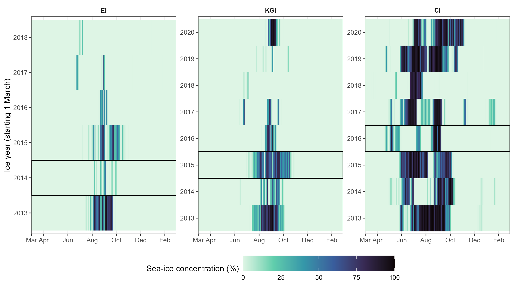
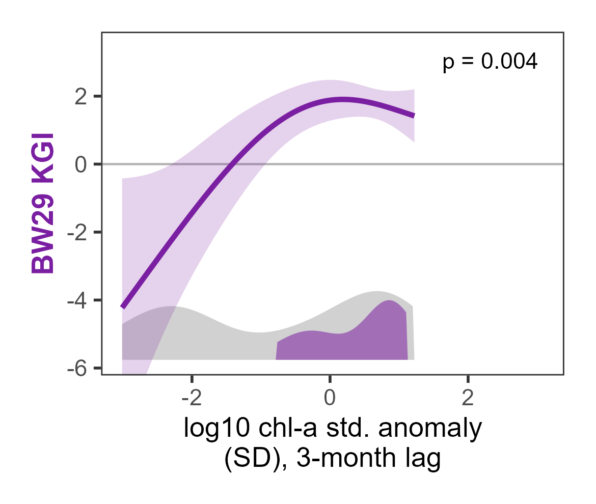
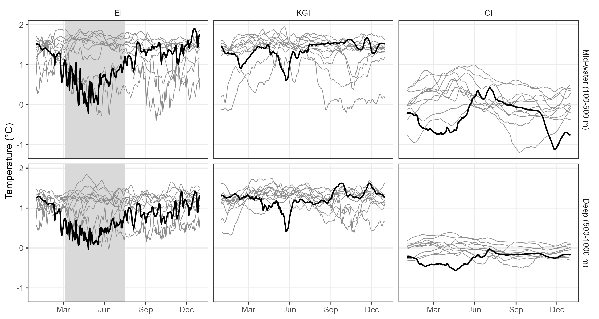
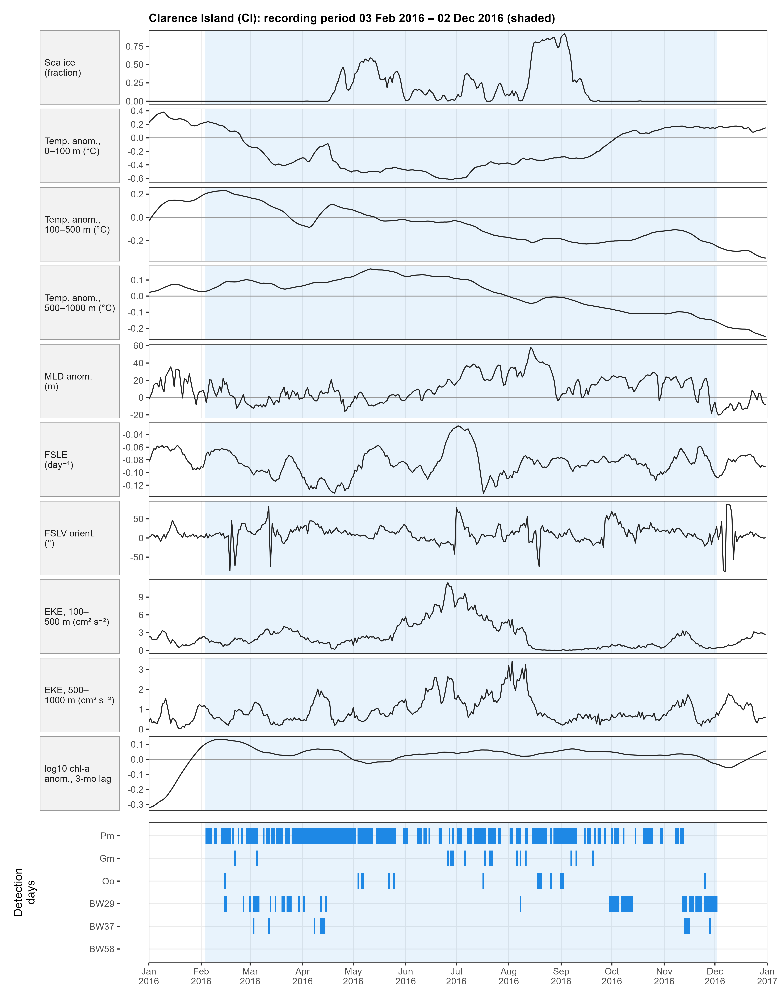

<!--
Working draft of the odontocete manuscript. Inline R numbers and all
tables built in R chunks are read from final_scripts_odontocetes/outputs/ by
_values.R, so they update when the analysis is re-run. Figures are read
directly from outputs/. Typed numbers (site positions, deployment dates,
profile counts, layer boundaries, duty-cycle results in the text) are static.
Render: quarto render manuscript.qmd   (or the Render button in VS Code)
Flags in red: \ins{} = to add; \conf{} = to verify. References are plain text
for now; convert to a .bib file at the end.
-->

```{r}
#| label: setup
source("_values.R")
```

# Abstract {.unnumbered}

Toothed whales are the most diverse group of top predators in the Southern Ocean, yet where and when they occur in Antarctic waters, particularly in winter, remains poorly known. Many of these species forage hundreds of metres below the surface, where Antarctic Circumpolar Current, Bellingshausen Sea and Weddell Sea waters meet around the Antarctic Peninsula. Habitat studies, however, have relied mostly on surface conditions and on summer ship-based surveys. How odontocete occurrence relates to sea ice and to conditions at foraging depth has therefore not been tested. Here we show, using year-round passive acoustic recordings at three sites in the South Shetland Islands (2014--2016), that sea ice and anomalous ocean conditions at the surface and at depth structure odontocete occurrence. `r cap_first(and_list(SP_TEXT[heavy_ice_species]))` were detected under more than 50% sea-ice cover, whereas long-finned pilot whales were never detected above `r ceiling(cutoff[["Gm"]])`% cover and two beaked whale signal types (BW29 and BW37) never above `r ceiling(cutoff[["BW29"]])`%. After the seasonal cycle was removed, warmer-than-usual surface water was associated with pilot whale presence at all three sites. Sperm whale and beaked whale presence was linked mainly to surface fronts, stratification and deep-layer temperature, and at single sites to eddy activity. Responses differed among sites, which sample distinct water masses but were also recorded in different years. \conf{site and year are confounded; keep this sentence descriptive} As sea ice retreats and warm Circumpolar Deep Water increasingly reaches the Antarctic Peninsula shelf, subsurface conditions may shape odontocete distribution as much as surface conditions do. Ocean reanalyses validated against in-situ profiles offer a way to include them in habitat models. \conf{wording of the habitat sentences after the final run}

# Introduction

\ins{Introduction to be written}

# Methods

## Study area {#sec-study}

Passive acoustic data were collected at three sites along the northern shelf slope of the South Shetland Islands, Antarctica: Elephant Island (EI; 60°53.214′S, 55°57.238′W; 762 m depth), King George Island (KGI; 61°27.469′S, 57°56.515′W; 768 m), and Clarence Island (CI; 61°15.112′S, 53°29.006′W; 1033 m) (@fig-map).

The South Shetland Islands lie at the confluence of water masses from the Drake Passage, the Bellingshausen Sea, and the Weddell Sea (@fig-map). To the north, the Southern Antarctic Circumpolar Current Front and the Southern Boundary of the Antarctic Circumpolar Current (ACC) follow the continental slope (Orsi et al. 1995), and the Southern Boundary passes close to the EI and KGI sites. Upper Circumpolar Deep Water from the ACC intrudes onto the northern South Shetland shelf as modified Circumpolar Deep Water (mCDW), particularly west of the Shackleton Transverse Ridge, whereas shelf waters are exported offshore north of Elephant Island, just downstream of the EI site (Zhou et al. 2013, Damini et al. 2025). South of the islands, the Bransfield Current flows northeastward along the southern slope of the South Shetland Islands, carrying relatively warm and fresh Transitional Zonal Water with Bellingshausen Sea influence (TBW; Sangrà et al. 2011, 2017, Veny et al. 2022), with part of the flow recirculating southwestward along the northern side of the islands (Dotto et al. 2021, Damini et al. 2025). Colder and saltier Transitional Zonal Water with Weddell Sea influence (TWW) enters Bransfield Strait from the east via the Antarctic Coastal Current and the Antarctic Slope Front around the tip of the Antarctic Peninsula (Heywood et al. 2004, Thompson et al. 2009) and is separated from TBW by the Peninsula Front (Sangrà et al. 2011, Veny et al. 2024). East of Elephant Island, the Antarctic Slope Front bifurcates over the South Scotia Ridge near the CI site, forming a westward branch and a quasi-stationary eddy (Thompson et al. 2009). The three sites therefore sample contrasting oceanographic regimes: EI near the shelf-water export pathway at the Shackleton Gap, KGI on the northern South Shetland slope beneath the Southern Boundary of the ACC, and CI under stronger Weddell Sea influence \conf{characterization of each site}.

High-frequency Acoustic Recording Packages (HARPs; Wiggins & Hildebrand 2007) were deployed sequentially at the three sites, sampling at 200 kHz. Recordings spanned 5 March -- 17 July 2014 at EI (134 days), 10 February 2015 -- 29 January 2016 at KGI (353 days), and 3 February -- 2 December 2016 at CI (302 days) (Table \ref{tab:deploy}). The EI and KGI recorders were duty-cycled (5 min on every 6 min and 10 min on every 13.33 min, respectively), whereas the CI recorder recorded continuously.

Bathymetry for the study-area map (@fig-map) was obtained from the Global Multi-Resolution Topography synthesis (GMRT v4.4.1; Ryan et al. 2009; accessed 11 May 2026 via GMRT MapTool) and contoured at 500-m intervals. Regional circulation (@fig-map) was illustrated with long-term (2009--2021) mean surface currents from the Copernicus Marine Service global ocean physics reanalysis (GLOBAL_MULTIYEAR_PHY_001_030, dataset version 202311, monthly means at 0.5 m; accessed 17 November 2026) and the positions of the Southern Antarctic Circumpolar Current Front and the Southern Boundary of the Antarctic Circumpolar Current from Orsi et al. (1995).

```{r}
#| label: deploy
data.frame(
  Site = c("Elephant Island (EI)", "King George Island (KGI)", "Clarence Island (CI)"),
  Latitude = c("60°53.214′S", "61°27.469′S", "61°15.112′S"),
  Longitude = c("55°57.238′W", "57°56.515′W", "53°29.006′W"),
  `Depth (m)` = c(762, 768, 1033),
  `Start (UTC)` = c("2014-03-05 00:00", "2015-02-10 00:00", "2016-02-03 23:59"),
  `End (UTC)` = c("2014-07-17 12:03", "2016-01-29 13:15", "2016-12-02 05:15"),
  `Duration (d)` = floor(c(134.5, 353.6, 302.2)),
  `Duty cycle` = c("5 of 6 min", "10 of 13.33 min", "Continuous"), check.names = FALSE) |>
  latex_table(paste("High-frequency Acoustic Recording Package (HARP) deployments at the three",
                    "sites in the South Shetland Islands: position, seafloor depth of the recorder,",
                    "recording period (UTC), duration (complete days) and duty cycle (recording",
                    "minutes per cycle). The CI recorder recorded continuously."),
              widths = c("2.6cm", NA, NA, NA, "1.9cm", "1.9cm", NA, "1.6cm"), size = 8)
```

![Study area and regional circulation around the South Shetland Islands, Antarctica. Circles mark the High-frequency Acoustic Recording Package (HARP) sites at Elephant Island (EI; 2014), King George Island (KGI; 2015--2016), and Clarence Island (CI; 2016), shown on GMRT bathymetry (v4.4.1; Ryan et al. 2009) with 500-m isobaths. Black arrows show mean surface currents for 2009--2021 from the Copernicus Marine Service global ocean physics reanalysis (GLORYS12V1). Black dashed and dot-dashed lines mark the Southern Antarctic Circumpolar Current Front (SACCF) and the Southern Boundary of the Antarctic Circumpolar Current (SB), respectively (Orsi et al. 1995). Colored lines show schematic pathways digitized from Damini et al. (2025): intrusion of modified Circumpolar Deep Water (mCDW); the Bransfield Current (BC), carrying Transitional Zonal Water with Bellingshausen Sea influence (TBW), and its recirculation; the Antarctic Coastal Current (ACoC), carrying Transitional Zonal Water with Weddell Sea influence (TWW); the Antarctic Slope Front (ASF) and associated eddy; and the Peninsula Front (PenF). The inset shows the location of the study area (red box) relative to the Antarctic Peninsula and South America.](../outputs/01_study_area/study_area_currents_map_schematic.png){#fig-map width=100%}

## Water-column structure {#sec-water}

To describe the water column at each site, daily potential temperature and practical salinity were taken from the Copernicus Marine Service global ocean physics reanalysis (GLOBAL_MULTIYEAR_PHY_001_030, dataset version 202311; 1/12°, daily means), and daily dissolved oxygen was taken from the companion global biogeochemistry hindcast (GLOBAL_MULTIYEAR_BGC_001_029, dataset version 202406; 1/4°, daily means), both accessed 17--18 November 2026 (@sec-env). Each variable was averaged over all ocean grid cells within a ±20 km box centered on each site, at every model level from the surface (0.5 m) to 1000 m. Because the shelf slope runs through each box, only part of the box reaches the deeper levels, so deep means represent only the cells deep enough to contain those levels. Oxygen was unavailable below the deepest water in the coarser biogeochemistry box (773 m at KGI, 1046 m at CI).

We divided the upper 1000 m into three layers, used both to describe the water column and to define the habitat predictors (@sec-stats): a surface layer (0--100 m), a mid-water layer (100--500 m), and a deep layer (500--1000 m). The boundaries were derived from the reanalysis at all three sites using two independent lines of evidence (@fig-layers). First, depths were grouped by how similarly their daily temperature--salinity anomalies varied over the 10-year record, using depth-constrained clustering (CONISS; Grimm 1987). Second, we identified water-mass features in the 10-year mean profiles: the deepest winter mixed layer, the Winter Water temperature minimum, the main pycnocline, and the warm-water core of Circumpolar Deep Water. The surface-layer base (100 m) lies below the deepest winter mixed layer and the Winter Water minimum (51--92 m) and coincides with the coherence breaks at EI and KGI (102--118 m). The mid-water layer contains the warm Circumpolar Deep Water core (temperature maximum at 266--454 m), and its base (500 m) lies near the coherence breaks below that core at EI and CI (462--502 m; 692 m at KGI). The deep layer was capped at 1000 m because, below ~1060 m, less than half of the KGI and CI boxes contains water.

Daily profiles were linearly interpolated onto a regular grid in the square root of depth (300 levels, no extrapolation) and displayed as one continuous depth--time section from January 2014 to December 2016 (@fig-sections). Each period used the box of the site that was recording, or about to record, in that period: EI for 2014, KGI for January 2015 -- January 2016, and CI for February -- December 2016. Daily AMSR2 sea-ice concentration for the same box (@sec-ice) was shown above the sections. Layer-mean temperature, salinity, oxygen and eddy kinetic energy were summarized as the mean ± SD over each site's recording period (Table S\ins{INSERT}). Temperature--salinity diagrams for each site's recording period were plotted with contours of potential density anomaly ($\sigma_\theta$) calculated at zero pressure using the UNESCO EOS-80 equation of state (oce R package 1.8-3; Kelley & Richards 2024) (@fig-ts).

![Daily water-column conditions from January 2014 to December 2016 in the upper 1000 m. The record is assembled from the ±20 km box around EI (2014), KGI (January 2015 -- January 2016), and CI (February -- December 2016). Thin vertical black lines mark where the source site changes, and colored outlines mark each site's recording period. Top: sea-ice concentration (%; AMSR2, box mean). Lower panels: potential temperature (°C), salinity, and dissolved oxygen (mmol m$^{-3}$) from the Copernicus Marine Service global physics reanalysis (temperature, salinity; 1/12°) and biogeochemistry hindcast (oxygen; 1/4°), plotted on a square-root depth axis with white contours (0.5 °C, 0.1, and 20 mmol m$^{-3}$, respectively). Dashed lines mark the boundaries of the surface (0--100 m), mid-water (100--500 m) and deep (500--1000 m) layers; right-hand labels give the species whose foraging depths fall in each layer (Pm, sperm whale; Gm, long-finned pilot whale; Oo, killer whale; BW29, southern bottlenose whale; BW37, BW37 beaked whale). Grey areas mark depths with no model water in the box; at KGI, oxygen is unavailable below 773 m, so the deep-layer oxygen mean there covers 500--773 m.](../outputs/02_deep_oceanography/ts_sections.png){#fig-sections width=100%}

## Sea ice {#sec-ice}

Daily sea-ice concentration was obtained from the AMSR2 ASI product of the University of Bremen (version 5.4; 6.25-km polar stereographic grid; Spreen et al. 2008 \conf{reference}) for 2013--2021 and averaged over a box extending ±20 km from each HARP (approximately 40 × 40 km), with open water counted as zero, so the daily box mean is the fraction of the box covered by ice. Gaps of up to 5 days (missing swaths) were filled by linear interpolation in the multi-year descriptive analyses only. For each day, the signed distance from the recorder to the nearest 15% ice edge was also computed: positive when the recorder's grid cell was in open water (distance to the nearest cell with ≥15% ice) and negative when it was within the ice (distance to the nearest cell with <15% ice). Cells within 12.5 km of land were excluded from this calculation, because passive-microwave pixels next to land are biased toward ice, and ice cells with fewer than two ice-covered neighbours were treated as noise. At 6.25 km, AMSR2 does not resolve leads or other small openings in the pack. Selected days with detections under heavy ice were therefore compared with MODIS true-colour imagery (Terra and Aqua; NASA Worldview \ins{REF}) (Supplement S4).

Acoustic occurrence was first described across sea-ice conditions as the percentage of time bins with detections in four sea-ice concentration classes (0--5, 5--15, 15--50 and >50%; @fig-iceocc), and daily detections were described against the signed distance to the ice edge (@fig-iceedge). Sea ice was then used in two ways in the models. First, for each species and site, acoustic presence was modeled against sea-ice concentration using all recording bins (@sec-stats), to describe how occurrence varied with the seasonal advance and retreat of the ice. Second, the habitat models (@sec-stats) were meant to test the influence of other environmental conditions only when each species could plausibly be present. They were therefore restricted, for each species, to time bins whose mean sea-ice concentration was no greater than the highest bin-mean concentration at which that species was detected, pooled across sites. The cutoffs were `r f1(cutoff[["Oo"]])`% for killer whales, `r f1(cutoff[["Pm"]])`% for sperm whales, `r f1(cutoff[["Gm"]])`% for long-finned pilot whales, and `r f1(cutoff[["BW29"]])`% for southern bottlenose whales and `r f1(cutoff[["BW37"]])`% for BW37 beaked whales (Table \ref{tab:icecut}). By construction, no bins with detections were excluded. The restriction removed no bins at EI. It removed `r removed("Oo", "CI")` two-day bins for killer whales at CI, `r removed("Gm", "CI")` (CI) and `r removed("Gm", "KGI")` (KGI) four-day bins for long-finned pilot whales, and `r removed("BW29", "CI")` (CI) and `r removed("BW29", "KGI")` (KGI) four-day bins for each beaked whale. Sea-ice concentration was therefore not a candidate predictor in the habitat models.

To place the recording years in context, sea-ice phenology was described for every complete ice year (1 March to the end of February) of each site's 10-year record (Supplement S4). Following Stammerjohn et al. (2008) \conf{reference}, ice advance was the first day of the ice year that began a run of at least 5 consecutive days with a box-mean concentration of at least 15%, retreat was the last day of the last such run, and the ice-season duration was the number of days from advance to retreat. Ice days (days with at least 15% ice), the maximum and mean concentration, and cumulative ice exposure (the sum of daily concentration, in full-ice-day equivalents) were also calculated. Differences among sites and years in the annual metrics were partitioned with a two-way analysis of variance (site + year) over the ice years common to all sites, and each recording day was assigned to a phase of its ice year (before advance, the first 30 days after advance, the ice season, the last 30 days before retreat, or after retreat). These analyses are descriptive.

## Acoustic detection {#sec-detect}

For beaked whales, sperm whales (*Physeter macrocephalus*), and long-finned pilot whales (*Globicephala melas*), echolocation signals were first detected with an expert system using a two-step approach (Roch et al. 2011) and then verified by an expert analyst. For beaked whales at EI, a previously published dataset of echolocation signals was used (Baumann-Pickering et al. 2015); the same data processing methods were replicated for beaked whales at KGI and CI, and for sperm whale and long-finned pilot whale signals at all sites. Killer whale (*Orcinus orca*) signals were identified by an expert analyst through manual review of long-term spectral averages (LTSAs) \conf{method and LTSA settings}. Beaked whale echolocation pulses were classified into southern bottlenose whale (*Hyperoodon planifrons*; BW29) and the BW37 and BW58 signal types. Previous work has hypothesized that the BW37 and BW58 echolocation pulses could be produced by Gray's (*Mesoplodon grayi*) and strap-toothed (*M. layardii*) beaked whales, respectively (Trickey et al. 2015, Baumann-Pickering et al. 2015, Barlow et al. 2021); Shepherd's beaked whale (*Tasmacetus shepherdi*) has also been proposed as a candidate for these unidentified signals (Barlow et al. 2021). Further research is still needed to confirm the species producing these echolocation pulses.

Only echolocation clicks were used to define presence; sperm whale slow clicks (n = 44 events) and killer whale high-frequency modulated signals (n = 3 events) were excluded. Verified detections were summarized into 5-min bins, and a bin was considered positive for a species if any detection overlapped it. Daily acoustic presence was quantified as the number of minutes in positive bins per day (positive bins × 5 min). Daily recording effort was calculated as the time within each deployment's recording period, accounting for partial first and last days and for the duty cycle at EI and KGI.

To assess whether duty cycling reduced detectability, the continuously recorded CI data were subsampled to the EI (5 min on every 6 min) and KGI (10 min on every 13.33 min) duty cycles at 100 random phase offsets, and the proportion of detection events, positive 5-min bins, and presence days retained was calculated for each species (Table \ref{tab:duty}; @fig-duty). Subsampling retained ≥ 89.6% of positive 5-min bins and ≥ 89.6% of presence days on average for all species under either duty cycle (lowest: sperm whales under the KGI duty cycle; ≥ 96.5% of presence days for all other species), despite recording only 83.3% (EI) and 75.0% (KGI) of the time. Because losses were far smaller than proportional to recording time, presence was not scaled by recording effort.

## Environmental data {#sec-env}

Environmental conditions at each site were characterized with daily output from the Copernicus Marine Service global ocean physics reanalysis (GLOBAL_MULTIYEAR_PHY_001_030, GLORYS12V1, dataset version 202311; 1/12° horizontal resolution, 50 vertical levels) and global biogeochemistry hindcast (GLOBAL_MULTIYEAR_BGC_001_029, dataset version 202406; 1/4° resolution), both accessed 17--18 November 2026 \ins{REF product DOIs}. From the physics reanalysis, we used potential temperature, zonal and meridional velocity, mixed layer depth, and sea-ice concentration (@sec-ice). Mixed layer depth is defined in this product as the depth at which density exceeds its value at 10 m by the amount equivalent to a 0.2 °C temperature decrease under local surface conditions. The biogeochemistry hindcast was used only for dissolved oxygen in the description and validation of the water column (@sec-valid). Following \ins{COMPANION PAPER}, fronts and surface mesoscale stirring were described with backward-in-time finite-size Lyapunov exponents (FSLEs) and the orientations of the associated finite-size Lyapunov vectors (FSLVs) (d'Ovidio et al. 2004), from the AVISO+ FSLE product computed from DUACS delayed-time multi-satellite absolute geostrophic velocities (version DT2024; 1/25°, daily; accessed 17--18 November 2026) \ins{REF AVISO+}.

Each variable was averaged daily over all ocean grid cells within ±20 km of each recorder (approximately 40 × 40 km). This area is larger than the distances over which the target species' echolocation clicks can be detected by a HARP: up to about 4 km for beaked whales (Zimmer et al. 2008, Hildebrand et al. 2015), \ins{range, with reference} for killer whales and long-finned pilot whales, and up to about 20 km for sperm whales, which at these latitudes are adult males \ins{REF}. It therefore includes the water around any detected animal. The box was also large enough to contain several grid cells of the coarser 1/4° biogeochemistry product (one cell spans ~28 km in latitude), whereas a ±10 km box would contain at most one. The ±20 km box contained 32--45 physics cells (EI 32, KGI 36, CI 45) and 3--6 biogeochemistry cells (EI 6, KGI 3, CI 3) at the surface.

Water-column variables were averaged over the three depth layers: surface (0--100 m), mid-water (100--500 m), and deep (500--1000 m). Each layer mean was weighted by thickness: each model level represents the depth interval between the midpoints to its neighbouring levels, and its weight is the overlap of that interval with the layer. Only grid cells with water at a level contributed, so deep-layer means represent the parts of the box deep enough to reach them. Eddy kinetic energy (EKE) was calculated in each grid cell and at each model level as $\frac{1}{2}(u'^2 + v'^2)$, where $u'$ and $v'$ are the daily velocity components minus that cell's 10-year mean at that level (Ducet et al. 2000 \conf{reference}), and then averaged over the box cells with water and over the mid-water and deep layers in the same way. Computing EKE per cell before averaging keeps eddies within the box from cancelling.

Mean FSLE included grid cells with an FSLE of zero, where the particle-separation threshold was not reached within the integration time; these zeros are valid values, not missing data. FSLV orientation is axial (orientations 180° apart describe the same front), so it was averaged by doubling the angles, taking the circular mean, and halving the result, using only the cells with nonzero FSLE (on average 87--95% of the box per day).

All variables were extracted for each site's deployment years ± 5 years (EI 2009--2019, KGI 2010--2021, CI 2011--2021). This 10-year record provided the climatologies used to deseason predictors (@sec-stats) and the reference mean flow for EKE. No predictor had missing values on any recording day.

### Model comparison and validation {#sec-valid}

To assess how much the water-column predictors depended on the choice of ocean model, and how well they reproduced observations, the Copernicus reanalysis was compared with an independent ocean model and with satellite and in-situ observations. HYCOM GOFS 3.1 (GLBv0.08; 1/12° × 1/25°, 40 depth levels) \ins{REF} daily temperature and salinity were obtained for each site's recording period, using the 3-hourly time step closest to 12:00 UTC. No single HYCOM experiment spans 2014--2016, so the reanalysis (experiment 53.X) was used for 2014 and the analysis experiments 56.3 and 57.2 thereafter. Daily sea surface temperature from the Aqua MODIS sensor (4 km, daytime, quality-masked; NOAA CoastWatch ERDDAP dataset erdMH1sstd1dayR20190SQ) \ins{REF} was used where at least 20% of the box's ocean pixels were valid. All products were averaged over the same ±20 km box around each site and matched by date. HYCOM was interpolated to the Copernicus model levels, and agreement was summarized as the mean difference (bias), root-mean-square error (RMSE) and Pearson correlation ($r$), for raw values and for anomalies from each product's monthly means over the matched days (@fig-hycom).

Both models were also compared with in-situ profiles from the World Ocean Database \ins{REF} in a wider region around the sites (60--63°S, 52--60°W) from 2014 to 2016: 915 profiles from instrumented seals, Argo floats, ship CTDs, bottle casts and expendable bathythermographs (@fig-insitu a). Only observations and profiles that passed the World Ocean Database quality control were used. For each profile, both models were sampled at the nearest grid cell with water on the profile's day (Copernicus daily mean; HYCOM time step nearest the profile time). Observed profiles were interpolated to the Copernicus model levels within their measured depth range, and oxygen was converted from µmol kg$^{-1}$ to mmol m$^{-3}$ using in-situ density. Bias, RMSE and $r$ were computed at each level and for thickness-weighted means of the three depth layers, using only profiles covering at least 80% of a layer and only profile--level combinations available in both models. Because both models assimilate some in-situ profiles (e.g., Argo), this comparison is not fully independent.

## Statistical analyses {#sec-stats}

Relationships between odontocete acoustic presence and environmental conditions were modeled with generalized additive models (GAMs). Separate models were fit for each species at each site. To reduce temporal autocorrelation, daily presence was aggregated into consecutive multi-day bins. For each species and site, a GAM of daily presence minutes on a smooth of days since the start of recording was fit, and the bin length was the first lag at which the autocorrelation of its residuals fell within the 95% confidence bounds. For comparability across sites, each species was assigned the longest bin length among its sites, capped at 4 days to retain at least 30 bins at the shortest deployment (EI, 135 days). Bins were 4 days long for all species except killer whales (2 days); the cap applied to `r capped_phrase`, whose residual autocorrelation lasted `r capped_lags` days, respectively. The response was the mean daily presence minutes within each bin. Species--site combinations with fewer than 10 bins containing detections were not modeled and are described only in @sec-occ (`r combo_phrase(not_modeled)`). Models with 10--20 bins with detections (`r combo_phrase(low_sample)`) were identified as low-sample models.

Two types of model were fit. Sea-ice models related presence to sea-ice concentration alone, using all bins, and describe the seasonal pattern of occurrence; because their residuals were strongly autocorrelated, they are reported in the supplement, and occurrence across sea-ice classes and relative to the ice edge is described in the Results (@sec-ice). Sea-ice models were fitted only where the species was detected in at least one bin with sea ice; where all detections were in ice-free bins, this is reported instead of a fitted curve, because the decline beyond the highest concentration with detections cannot be estimated. Habitat models related presence to the remaining environmental predictors, using only bins with sea-ice concentration no greater than the highest concentration at which the species was detected (@sec-ice). Because the seasonal pattern is described by the sea-ice models, the habitat models were designed to test responses to conditions that were unusual for the time of year. All habitat predictors with a seasonal cycle were therefore expressed as anomalies from a 10-year climatology (deployment years ± 5 years): the 12 monthly means were interpolated to daily values with a periodic cubic spline and subtracted from the daily values. EKE, FSLE and FSLV orientation have almost no seasonal cycle (the seasonal cycle explained ≤ 8% of their daily variance at every site) and were used as raw values.


The candidate predictors of each species were defined a priori, from its foraging depths and from the processes thought to concentrate its prey, and the same candidate set was used at every site where the species was modeled (Tables \ref{tab:pred} and \ref{tab:species}). Surface fronts were represented by backward-in-time FSLE, which identifies Lagrangian fronts where water masses converge and plankton accumulate (d'Ovidio et al. 2004); top predators track these structures (Tew Kai et al. 2009; Cotté et al. 2011; Della Penna et al. 2015), and fronts are important foraging habitat in the Southern Ocean (Bost et al. 2009). Front orientation (FSLV; AVISO+ FSLE product \ins{REF/DOI}) has not, to our knowledge, been used in predator studies and was included as an exploratory predictor, as in the companion baleen whale analysis \ins{REF}. Stratification was represented by the mixed layer depth anomaly, a standard predictor in dynamic cetacean habitat models (Becker et al. 2016 \conf{author list}). Eddy activity was represented by EKE in the layers each species forages in; eddies have been linked to sperm whale and other odontocete distributions (Biggs et al. 2005 \conf{author list}; Woodworth et al. 2012), and deep-layer conditions explained sperm whale habitat better than surface conditions in the Bay of Biscay (Virgili et al. 2022 \conf{author list}). Water masses were represented by the temperature anomaly of each foraging layer, because intrusions of warm Upper Circumpolar Deep Water structure the Antarctic Peninsula shelf ecosystem (Prézelin et al. 2000; Couto et al. 2017), and temperature was the only water-mass variable the reanalysis reproduced well in all three layers (@sec-valid; $r$ = `r r_T_range` for layer means, versus `r r_S_mid_cop` for mid-water salinity and ≤ `r r_O2_max` for oxygen). Surface fronts, front orientation and stratification were candidates for all species, and temperature and EKE were included for the layers each species forages in according to tag studies (Table \ref{tab:species}).

All models used a Tweedie distribution with a log link (power parameter estimated between 1.1 and 1.9), smoothing parameters estimated by restricted maximum likelihood (REML), and thin-plate regression splines with a basis dimension of 4. FSLV orientation was fit with a cyclic cubic spline joined at ±90°, because orientations differing by 180° are equivalent (Haller 2015). For each species and site, terms were removed from the candidate set by backward selection, using additional shrinkage of smooth terms (`select = TRUE`; terms with about 1 effective degree of freedom are effectively linear; Marra & Wood 2011), until all remaining terms were significant ($p$ ≤ 0.05). The final model was then checked for collinearity: if any term had a variance inflation factor (VIF) above 5 (Zuur et al. 2010), the least significant of those terms was removed and selection was repeated. No final model needed this step (highest VIF `r vif_final_max`). To limit overfitting, the number of smooth terms was restricted following the guideline of at least 10 observations per estimated term (Peduzzi et al. 1996, Harrell 2015) \conf{references}. Each model was allowed at most one term per 10 bins; in low-sample models (10--20 bins with detections), where the bins with detections rather than all bins carry most of the information, at most two terms were allowed (i.e., about one term per 10 bins with detections). The limit was applied during backward selection: once all remaining terms were significant, the least significant term continued to be removed until the model met the limit. With shrinkage, smooth terms in the final models had a median of `r edf_median` effective degrees of freedom (range `r edf_min`--`r edf_max`).
Model fit was assessed with residual diagnostics, basis-dimension checks and concurvity (Table \ref{tab:diagnostics}). Residual autocorrelation was tested with a Ljung--Box test over lags 1--5 bins, computed on the bin series with bins removed by the ice filter treated as gaps. As a sensitivity analysis, each final model was refit with an additional first-order autoregressive (AR(1)) process in glmmTMB (Brooks et al. 2017), keeping the same smooth terms (FSLV orientation as $\sin 2\theta$ and $\cos 2\theta$). AR(1) was retained where it lowered AIC by more than 2, and each term was then tested by a likelihood-ratio test (Supplement S5). Analyses were conducted in R 4.5.1 (R Core Team 2025) with the packages mgcv `r packageVersion("mgcv")` (Wood 2017), car `r packageVersion("car")` (Fox & Weisberg 2019), gratia `r packageVersion("gratia")` (Simpson 2024) and glmmTMB `r packageVersion("glmmTMB")` (Brooks et al. 2017).

Because presence and the predictors are both autocorrelated, a model can select predictors that explain much deviance by chance alignment of slow fluctuations. We therefore repeated the whole selection procedure on time-shifted predictors (time-shift permutation test). In each of `r perm_n` runs per model, the predictors at a site were replaced by that site's predictors from another year (1--10 years earlier or later) at the same time of year, offset by a random 0--60 days, while presence, sea ice and the ice filter stayed on the real dates. This keeps the seasonal timing and the autocorrelation of both series but breaks their alignment. Backward selection with the term cap and the VIF check was rerun in each shifted run (runs with no significant term were given 0% deviance explained). The permutation p-value was the proportion of runs, counting the observed one, whose selected model explained at least as much deviance as the observed model, and p-values were adjusted across the 11 models with the Benjamini--Hochberg procedure. Because shifted predictors come from the same site and season and the selection step is repeated on them, the test is conservative, and with one recording year per site its power is low.

```{r}
#| label: pred
data.frame(
  Predictor = c("Potential temperature", "FSLE (backward-in-time)", "FSLV orientation (cyclic)",
                "EKE, ½(u′² + v′²) per grid cell", "Mixed layer depth",
                "Sea-ice concentration"),
  Represents = c("Water mass", "Surface fronts and stirring", "Orientation of surface fronts",
                 "Eddy activity at foraging depth", "Stratification",
                 "Seasonal ice cover"),
  Layer = c("Mean of each layer used", "Surface", "Surface", "Mid-water and/or deep", "Surface",
            "Surface"),
  Units = c("°C", "day⁻¹", "°", "cm² s⁻²", "m", "%"),
  Form = c("Anomaly", "Raw", "Raw", "Raw", "Anomaly", "Raw"),
  Model = c(rep("Habitat", 5), "Sea-ice models; ice cutoff"),
  Source = c("Copernicus PHY", "AVISO+", "AVISO+", "Copernicus PHY", "Copernicus PHY",
             "AMSR2 ASI (Univ. Bremen)")) |>
  latex_table(paste("Environmental predictors. Habitat-model candidates are listed first;",
                    "sea-ice concentration was used only in the sea-ice models and to set the ice cutoff for",
                    "the habitat models (Section 2.3). Layers: surface 0--100 m; mid-water",
                    "100--500 m; deep 500--1000 m. The layers used by each species are given in",
                    "Table \\ref{tab:species}."),
              widths = c("3cm", "2.8cm", "2.2cm", "1.3cm", "1.8cm", "1.8cm", "1.8cm"), size = 8,
              hlines = 5)
```

```{r}
#| label: species
data.frame(
  Species = c("Sperm whale", "Long-finned pilot whale", "Killer whale",
              "Southern bottlenose whale (BW29)", "BW37 beaked whale"),
  `Foraging depths (tag studies)` = c(
    "Foraging dives: mean individual maximum 644--985 m (Atlantic, Gulf of Mexico, Ligurian Sea; 37 whales; Watwood et al. 2006); South Georgia male: natural foraging dives mean 345 m, maximum 1343 m (Towers et al. 2019)",
    "Mostly in the top ~16 m by day, deep dives after dusk to 360--648 m (Ligurian Sea; Baird et al. 2002); 60% of time above 7 m, maximum 828 m (Faroe Islands; Heide-Jørgensen et al. 2002); foraging dives 121--615 m (northern Norway; Visser et al. 2017)",
    "Antarctic Peninsula and Ross Sea: mean dive depth 36--43 m (types A, B1) and 115--122 m (types B2, C), types B2/C regularly 300--500 m, maxima 550--710 m (Pitman et al. 2020); sub-Antarctic: mostly 7.5--50 m, foraging bouts to ~370 m (Reisinger et al. 2015)",
    "No tag data. Northern bottlenose whale: regular dives > 800 m, maximum 1453 m (Hooker & Baird 1999)",
    "No tag data for Gray's beaked whale. Blainville's beaked whale: foraging dives mean 835 m; Cuvier's beaked whale: mean 1070 m (Tyack et al. 2006)"),
  `Layers` = c("Mid-water, deep", "Surface, mid-water", "Surface, mid-water", "Deep", "Deep"),
  `Candidate predictors` = c(
    "FSLE, FSLV, MLD; temperature and EKE (mid-water, deep)",
    "FSLE, FSLV, MLD; temperature (surface, mid-water); EKE (mid-water)",
    "FSLE, FSLV, MLD; temperature (surface, mid-water); EKE (mid-water)",
    "FSLE, FSLV, MLD; temperature and EKE (deep)",
    "FSLE, FSLV, MLD; temperature and EKE (deep)"),
  check.names = FALSE) |>
  latex_table(paste("Foraging depths, water-column layers and candidate predictors of each species.",
                    "Surface fronts (FSLE, FSLV orientation) and stratification (mixed layer depth,",
                    "MLD) were candidates for all species; temperature (anomaly) and EKE were",
                    "included in the layers each species forages in. Surface temperature was",
                    "included for pilot and killer whales, which spend much of their time near the",
                    "surface. No dive data exist for southern bottlenose whales or the species",
                    "producing BW37, so congeners were used as proxies."),
              widths = c("2.6cm", "7.4cm", "1.9cm", "3.6cm"), size = 8)
```

### Site and year comparison {#sec-siteyear}

Each site was recorded in a different year (EI 2014, KGI 2015--2016, CI 2016), so site and year are confounded in the acoustic data. The environmental records, however, cover all three sites in every year, so whether the sites differ, and whether the recording years were typical for each site, can be tested directly. Daily values are strongly autocorrelated, so tests on them would greatly overstate the evidence; instead, each test used one value per site per year, with years as replicates. For each predictor and sea ice, annual means at the three sites were computed for every year with at least 90% data coverage at all three sites (`r sy_years`, n = `r sy_n_years` years; sea ice 2013--2019, n = 7). Differences among sites were tested with a two-way ANOVA with year as a block and site as the factor, followed by two-sided paired *t*-tests between each pair of sites (years paired), with p-values Holm-adjusted within each variable. Annual means were used so that the full seasonal cycle, including the ice season, is represented equally at every site; the tests were repeated for the period covered by all three recordings (5 March--17 July, which is also the EI recording period) as a sensitivity check. The largest lag-1 correlation between consecutive annual means at any site was `r f2(max(sy_sites$max_abs_lag1_r[sy_sites$window == "annual"]))`, so treating years as independent is a reasonable approximation. To assess whether each recording year was typical for its site, the mean of each variable over the recording period was ranked against the same calendar window in every other year of that site's record (7--12 years) and expressed as a z-score relative to the other years. With so few years, the smallest possible two-sided rank p-value is 0.17--0.29, so these comparisons are descriptive. Finally, for each pair of recordings, the observed difference over 5 March--17 July was split into the long-term site difference (the mean difference over all years) and the remainder, attributable to the recording years.

### Statistics and reproducibility {#sec-repro}

Habitat and sea-ice GAMs were fitted to binned time series (n = `r min(hab_terms$n_bins)`--`r max(hab_terms$n_bins)` bins per habitat model; Table \ref{tab:habitat}). P-values of smooth terms are the approximate Wald tests of mgcv (Wood 2013 \conf{reference}); the Tweedie response does not assume normality. Residual autocorrelation was tested with Ljung--Box tests (lags 1--5 bins), and terms in the AR(1) sensitivity models with likelihood-ratio ($\chi^2$) tests. The time-shift permutation test was one-sided (upper tail; `r perm_n` runs per model), with Benjamini--Hochberg adjustment across the 11 models. Site differences were tested with two-way ANOVA (F test) and two-sided paired *t*-tests on annual means (n = 7--9 years) with Holm adjustment; because these samples are small, the number of years in which each pairwise difference had the same sign is reported alongside as a distribution-free summary. The significance level was 0.05 for all tests, and exact p-values are reported. All analyses were scripted in R and every number, table and figure in this paper is regenerated from the input data by those scripts.

### Use of large language models {#sec-llm}

Claude (Anthropic) was used to help write and revise the analysis code and to draft and edit parts of the manuscript text. All code, analyses and text were checked by the authors, who take full responsibility for the content. \conf{wording of the LLM statement}

### Code availability {#sec-code}

The R code used for all analyses and figures is available at \ins{repository URL; GitHub repository archived with a Zenodo DOI at publication}.

# Results

## Acoustic occurrence {#sec-occ}

Odontocetes were detected at all three sites, but occurrence differed strongly among species and among sites/years (Table \ref{tab:occurrence}; @fig-weekly). Because each site was recorded in a different year (EI 2014, KGI 2015--2016, CI 2016), differences among sites are site/year differences. The environmental records, which cover all three sites in every year, showed that the sites themselves differ: in annual means over `r sy_years`, CI was colder at mid-water and deep layers, had more sea ice, a shallower mixed layer, weaker FSLE and lower EKE than EI and KGI in almost every year (site effect p < 0.001 for every variable except surface temperature), whereas EI and KGI had similar water-mass temperatures, mixed layer depths and sea ice and differed mainly in eddy activity (Supplement S7).

Sperm whales were the most frequently detected species at EI (`r occ_txt("Pm", "EI")` of `r rec_days("EI")` recording days) and CI (`r occ_txt("Pm", "CI")` of `r rec_days("CI")` days) but were never detected at KGI, despite `r rec_days("KGI")` recording days. At EI they were first detected in April and were present on almost every day in May (97%); at CI they were present in every month from February to November, on 100% of days in April, and declined in November--December. Long-finned pilot whales were detected on `r occ_txt("Gm", "EI")` at EI, `r occ_txt("Gm", "KGI")` at KGI and `r occ_txt("Gm", "CI")` at CI. At EI and KGI their detections increased through austral autumn into early winter (EI: 36--100% of days from May to July; KGI: 32--50% of days in May--June), and at KGI they were absent from July to October; at CI, detections were sparse and spread from June to September.

Southern bottlenose whales (BW29) were detected at all three sites (EI `r occ_txt("BW29", "EI")`, KGI `r occ_txt("BW29", "KGI")`, CI `r occ_txt("BW29", "CI")`). At EI their detections increased toward winter (82% of days in July); at KGI they were detected only from February to June; and at CI they were detected in late summer and autumn (mainly March) and again from October, on every day of December. BW37 was detected on `r occ_txt("BW37", "EI")` at EI, `r occ_txt("BW37", "KGI")` at KGI and `r occ_txt("BW37", "CI")` at CI, mostly in late summer and autumn and, at KGI, again in November--December (63% of days in November). Killer whales and BW58 were rare: killer whales were detected on `r occ_days("Oo", "EI")`, `r occ_days("Oo", "KGI")` and `r occ_days("Oo", "CI")` days at EI, KGI and CI, and BW58 on `r occ_days("BW58", "EI") + occ_days("BW58", "KGI")` days in total (EI and KGI only).

```{r}
#| label: occurrence
occurrence_table() |>
  latex_table(paste("Acoustic occurrence of odontocetes at each site: number of days with detections",
                    "(percentage of recording days) and total hours with detections (sum of positive",
                    "5-min bins). Recording days: EI", rec_days("EI"), ", KGI", rec_days("KGI"), ", CI",
                    paste0(rec_days("CI"), ". Sites were recorded in different years.")),
              widths = c("4cm", "3.6cm", "3.6cm", "3.6cm"), size = 9)
```

![Weekly acoustic presence of odontocetes at Elephant Island (EI; 2014), King George Island (KGI; 2015--2016) and Clarence Island (CI; 2016), in the units used as the response in the habitat models: minutes per recorded day with detections (positive 5-min bins), averaged over each week. Each panel has its own y axis. Grey ticks at zero mark weeks that were recorded without detections, and dark grey shading marks periods without recording. Panels show sperm whales (Pm), long-finned pilot whales (Gm), killer whales (Oo), southern bottlenose whales (BW29) and the BW37 and BW58 beaked whale signal types. BW58 was detected on only three days and was not modeled.](../outputs/07_results_occurrence/fig_weekly_presence.png){#fig-weekly width=100%}

## Occurrence across sea-ice conditions {#sec-iceocc}

Sea-ice conditions differed among sites/years: EI had no ice during recording (all bins below 5% concentration), whereas at KGI and CI ice exceeded 50% in `r ice_bins_class("KGI", ">50")` and `r ice_bins_class("CI", ">50")` four-day bins, respectively (@fig-iceocc). Sperm whales and killer whales were the only species detected under heavy ice. At CI, sperm whales were detected in all `r ice_occ_txt("Pm", "CI", ">50")` bins with more than 50% ice, and killer whales were detected in `r ice_occ_txt("Oo", "CI", ">50")` two-day bins with more than 50% ice, the highest proportion of any ice class for that species. Long-finned pilot whales were detected in bins with up to 15--50% ice at CI (`r ice_occ_txt("Gm", "CI", "15–50")` bins) but never above 50%, and at KGI only in bins with less than 5% ice. Southern bottlenose whales and BW37 were detected only in bins with less than 5% ice; at KGI and CI, none of the `r ice_bins_class("KGI", "5–15") + ice_bins_class("KGI", "15–50") + ice_bins_class("KGI", ">50")` and `r ice_bins_class("CI", "5–15") + ice_bins_class("CI", "15–50") + ice_bins_class("CI", ">50")` bins with 5% ice or more contained beaked whale detections. Sea-ice models could therefore be fitted only at CI for sperm, killer and pilot whales (Supplement S4). Sperm whale and killer whale presence peaked at intermediate to high concentrations; only the killer whale effect remained significant when residual autocorrelation was modeled, and the pilot whale effect was not significant.

The sea-ice context of each recording differed more than the site means suggest (@fig-iceheat; @fig-icetimeline). All three sites share the same seasonal regime (ice-free from about December to April, ice cover from about June to October), and differences among years were at least as large as differences among sites: over the `r ice_anova$n_years[1]` ice years common to all sites, site explained `r ice_anova_pct("cumulative_ice_days", "pct_site")`% and year `r ice_anova_pct("cumulative_ice_days", "pct_year")`% of the variance in cumulative ice exposure. Heavy-ice years were shared by EI and KGI (Spearman $r$ = `r ice_sync_r("EI-KGI")`) but less so with CI ($r$ = `r ice_sync_r("EI-CI")`--`r ice_sync_r("KGI-CI")`). The recording at EI ended on 17 July 2014, before that year's ice advance (`r rec_ph("EI", "advance_date")`), so EI was sampled only during the open-water season. KGI in 2015 had the longest ice season (`r rec_ph("KGI", "duration_days")` days, `r rec_ph("KGI", "advance_date")` to `r rec_ph("KGI", "retreat_date")`), the most ice days and the latest retreat of its `r ice_n_years("KGI")`-year record. CI in 2016 had an early advance (`r rec_ph("CI", "advance_date")`) and an early retreat (`r rec_ph("CI", "retreat_date")`) and intermittent ice between them, with cumulative exposure below the median for that site (`r ice_pctl("CI", "cumulative_ice_days")`th percentile). At KGI, no species except killer whales was detected between ice advance and retreat; pilot whales and both beaked whales were detected until early July, and BW37 again after retreat (`r phase_pct("KGI", "BW37", "after retreat")`% of days). At CI, sperm whales were detected on `r phase_pct("CI", "Pm", "ice season")`% of days during the ice season, whereas southern bottlenose whales and BW37 were detected only before advance and after retreat. These patterns are descriptive and come from a single year per site.

Relative to the ice edge (@fig-iceedge), the recorder was inside the 15% ice edge on `r ie("Pm", "KGI", "days_inside")` recording days at KGI and `r ie("Pm", "CI", "days_inside")` at CI, and never at EI. At CI, sperm whales were detected on `r ie("Pm", "CI", "detection_days_inside")` of the `r ie("Pm", "CI", "days_inside")` days inside the edge (`r round(ie("Pm", "CI", "pct_inside_days_with_detection"))`%, compared with `r round(ie("Pm", "CI", "pct_outside_days_with_detection"))`% of days outside it), up to `r round(ie("Pm", "CI", "max_km_inside"))` km from the nearest edge (`r ie_date("Pm", "CI")`, `r round(ie("Pm", "CI", "ice_pct_at_max_inside"))`% box-mean ice). Killer whales were detected inside the edge on `r ie("Oo", "CI", "detection_days_inside")` of their `r ie("Oo", "CI", "detection_days")` detection days at CI (up to `r round(ie("Oo", "CI", "max_km_inside"))` km) and on one day at KGI, `r round(ie("Oo", "KGI", "max_km_inside"))` km inside the edge under `r round(ie("Oo", "KGI", "ice_pct_at_max_inside"))`% ice (`r ie_date("Oo", "KGI")`). Long-finned pilot whales were detected inside the edge on `r ie("Gm", "CI", "detection_days_inside")` days at CI (up to `r round(ie("Gm", "CI", "max_km_inside"))` km) and never at KGI. Southern bottlenose whales, BW37 and BW58 were never detected while the recorder was inside the ice edge. On 21 August 2016, a day with sperm whale detections and 81% box-mean ice in AMSR2, the MODIS image showed large floes separated by leads that the 6.25-km AMSR2 grid does not resolve (@fig-icemaps).

{#fig-iceedge width=100%}


## Species--site combinations with few detections

Three species--site combinations had too few detections to model (killer whales at EI and KGI, 3 detection days each; BW37 at CI, 11 days; Table \ref{tab:rare}). Killer whale detections at KGI coincided with high eddy kinetic energy in the mid-water and deep layers (97th percentile of recording days), and one of the three detections occurred under 70% sea-ice cover. BW37 at CI was detected only in ice-free periods (March--April and November), on days with above-typical deep-layer eddy kinetic energy (76th percentile).

## Choice of ocean model

The Copernicus reanalysis agreed with the independent observations at least as well as HYCOM did, and it was used for all predictors. Against MODIS surface temperature, Copernicus had smaller warm biases than HYCOM at all sites (`r modis_bias("Copernicus")` °C vs `r modis_bias("HYCOM")` °C; @fig-hycom a). At depth, the two models differed by a near-constant offset, with HYCOM up to ~1 °C warmer than Copernicus at EI (@fig-hycom b). Against in-situ profiles, Copernicus reproduced layer-mean temperature well in all three layers ($r$ = `r f2(r_T[["surface"]])`, `r f2(r_T[["mid"]])` and `r f2(r_T[["deep"]])` for the surface, mid-water and deep layers), with smaller biases than HYCOM in the mid-water (`r bias_T("Copernicus", "mid")` vs `r bias_T("HYCOM", "mid")` °C) and deep layers (`r bias_T("Copernicus", "deep")` vs `r bias_T("HYCOM", "deep")` °C) and similar skill at the surface (@fig-insitu b). In contrast, Copernicus mid-water salinity was poorly reproduced ($r$ = `r r_S_mid_cop`; HYCOM $r$ = `r r_S_mid_hyc`), and Copernicus oxygen showed no positive correlation with observations below the surface layer. Copernicus also provides mixed layer depth and a matching biogeochemistry hindcast from one consistent multi-year system, whereas no single HYCOM experiment covered the study period. Temperature was therefore used as the only water-mass variable in the habitat models (@sec-stats).

## Habitat associations (exploratory)

The final habitat models explained `r f1(min(hab_terms$dev_expl_model_pct))`--`r f1(max(hab_terms$dev_expl_model_pct))`% of the deviance (Table \ref{tab:habitat}; @fig-curves), and no final model had a VIF above `r vif_final_max`. Because each model rests on one recording year and few independent bins, the associations are exploratory. Of the `r n_terms_testable` testable terms, `r n_terms_hold` remained significant when residual autocorrelation was modeled with an AR(1) process; the others are marked in Table \ref{tab:habitat}.

*Sperm whales.* At EI, presence peaked at intermediate FSLE and decreased when the mixed layer was deeper than usual (both robust to AR(1)), and decreased with warmer-than-usual deep water (not robust). At CI, presence increased with warmer-than-usual deep water (robust), decreased with FSLE and was U-shaped with mid-water EKE (neither robust). The deep-temperature response therefore had opposite signs at the two sites; deep-layer anomalies at EI were almost all negative in 2014 (Supplement S7).

*Long-finned pilot whales.* All three pilot whale models were low-sample models. Surface temperature anomaly was retained at every site and remained significant under AR(1): presence increased with warmer-than-usual surface water at EI and KGI but decreased at CI. Presence was U-shaped with mid-water temperature anomaly at EI (robust) and peaked at intermediate mixed layer anomalies at KGI (robust) and CI (not robust).

*Killer whales.* At CI (low sample), presence was U-shaped with surface temperature anomaly and decreased with mid-water EKE; neither term was robust to AR(1).

*Beaked whales.* Southern bottlenose whale (BW29) presence decreased with deep-layer EKE at EI, and decreased when the mixed layer was deeper than usual at KGI and CI. Deep temperature anomaly was retained at both KGI (increasing) and CI (decreasing). None of the BW29 terms remained significant under AR(1). BW37 presence was U-shaped with FSLE and varied with FSLV orientation at EI (both robust), and at KGI peaked at intermediate deep temperature anomalies (robust) and was U-shaped with mixed layer anomaly (not robust).

In the time-shift permutation test, no final model explained more deviance than models selected from predictors shifted to other years (permutation p = `r perm_p_range`; Benjamini--Hochberg-adjusted p ≥ `r perm_pbh_min`; Supplement S5). The habitat associations above should therefore be treated as hypotheses for future multi-year studies rather than as established responses.

![Partial effects (log scale, centered) of the predictors retained in the final habitat GAMs with two or more terms. Rows are species--site models (Pm, sperm whale; Gm, long-finned pilot whale; Oo, killer whale; BW29, southern bottlenose whale; BW37, BW37 beaked whale), colored by site (EI, pink; KGI, purple; CI, blue); columns are predictors, with a common x axis within each column. Lines show the fitted smooth and shading its 95% confidence band, drawn over the range of values observed at that site; ticks along the bottom show the observed values of each time bin. Each row has its own y axis, and the p-value of each term is given in the panel. Empty cells mark predictors that were not retained in that model. Models with a single term are shown in @fig-curvesall, and all terms are listed in Table \ref{tab:habitat}.](../outputs/08_results_gams/main_stage3_habitat_response_curves_grid.png){#fig-curves width=72%}

```{r}
#| label: habitat
hab_tbl <- habitat_table()
hab_tbl |>
  latex_table(hlines = attr(hab_tbl, "species_end"), caption =paste("Final habitat models (Tweedie GAMs) for each species and site. Predictors are",
                    "anomalies from the 10-year climatology except FSLE, FSLV orientation and EKE.",
                    "Term deviance explained is the decrease in deviance explained when the term is",
                    "removed and the model refit, so terms need not sum to the model total. Shape",
                    "describes the fitted smooth. ‡ Low-sample model (10--20 bins with detections;",
                    "at most two terms). † Term not significant when residual autocorrelation was",
                    "modeled with an AR(1) process, or when refit by maximum likelihood (Supplement S5).",
                    "Bins were 4 days long (killer whales, 2 days)."),
              widths = c("1.9cm", NA, "1.3cm", NA, "3.6cm", NA, NA, NA, "2.2cm"), long = TRUE)
```

# Discussion

\ins{Discussion to be written. Points noted so far: residual autocorrelation remained in `r n_lb_fail` of `r n_models` habitat models (Ljung--Box p ≤ 0.05; `r lb_fail_phrase`), and AR(1) retained `r n_terms_hold` of `r n_terms_testable` testable terms; qualitative description of the rare species--site combinations.}

\ins{Draft note, concurvity:} Some predictors in the same model overlapped nonlinearly even though they passed the collinearity screen. VIF measures only linear overlap, whereas concurvity measures how well one smooth term can be reproduced by the others. Pairs with a worst-case concurvity above `r CONCURVITY_FLAG` were `r concurvity_phrase`. The models as a whole are unaffected, but the separate effects of these pairs cannot be cleanly separated, and their individual response curves should be interpreted together.

\ins{Draft note, site/year:} Each site was recorded in a different year, so differences between sites are site/year differences. Tests on annual means over `r sy_years` showed that the sites differ consistently: site explained `r sy_pct("temperature_mid", "pct_var_site")`--`r sy_pct("temperature_deep", "pct_var_site")`% of the variance in mid-water and deep temperature and `r sy_pct("FSLE", "pct_var_site")`% in FSLE, and CI differed from EI and KGI in every variable except surface temperature (Supplement S7). Differences between CI and the other two sites are therefore likely to reflect site. EI and KGI, in contrast, sample similar water masses, so differences between them are more likely to include a year effect: EI 2014 had the coldest deep layer of its record, an anomaly that began abruptly at the end of February 2014 and was also weakly present at KGI and CI. Cold periods of similar size occurred at EI in 2009 and 2010, so the anomaly is within the range of variability at that site, but it could not be confirmed with in-situ data. Because of this anomaly, deep-layer temperature anomalies at EI cannot be separated from site. Models fitted to pairs of sites, or all three, with a shared smooth plus site intercept versus site-specific smooths found that most responses differed among sites or could not be resolved; the only response shared in every combination was lower presence of southern bottlenose whales (BW29) when the mixed layer was deeper than usual, and it did not hold when residual autocorrelation was modeled. \conf{pooled-model results typed from outputs/06\_statistical\_analyses/site\_pooled; not reported in the supplement}

\ins{Draft note, sea ice:} The sea-ice results reflect both ice and season and should be interpreted with the phenology of each recording year. EI was recorded only before ice advance, so it provides no information on responses to ice. The absence of beaked whales and pilot whales at KGI between ice advance and retreat coincided with the longest ice season in that site's record, and at CI the ice in 2016 arrived early and was intermittent, which may explain why sperm and killer whales were detected at high concentrations there. With one year per site, responses to sea-ice concentration cannot be separated from the timing of the ice season.

\ins{Draft paragraph, detections inside the ice edge:} Sperm whales at CI were detected on most days when the recorder was inside the 15% ice edge, as far as `r round(ie("Pm", "CI", "max_km_inside"))` km from the nearest edge, and killer whales up to `r round(ie("Oo", "CI", "max_km_inside"))` km. This does not mean that the whales were beneath unbroken ice. The ice edge and box-mean concentration come from a 6.25-km passive-microwave product, which does not resolve leads, polynyas or other openings smaller than a few kilometres, and a MODIS image of a heavy-ice day with sperm whale detections at CI showed large floes separated by leads within the box (@fig-icemaps). Both species need to surface to breathe, and a sperm whale foraging dive lasts about 45 min (Watwood et al. 2006), so the most likely explanation is that they used leads and openings in the pack, as reported for other cetaceans in Antarctic pack ice \ins{REF, e.g., minke whales and killer whales in pack ice}. Passive acoustic detections also integrate over several kilometres (\ins{detection range}), so whales may have been vocalizing at the margins of openings rather than directly above the recorder. Distances inside the edge should therefore be read as a measure of how far into the ice-covered region detections occurred, not of the ice conditions experienced by the whales. In contrast, beaked whales were never detected inside the ice edge and pilot whales rarely, consistent with their absence from bins with more than 15--50% ice (@fig-iceocc).

\ins{Further points: residual autocorrelation and the AR(1) results; detection may vary with ambient noise (sea ice, wind), which was not modeled; validation tested raw values whereas models use anomalies; permutation test results.}

\clearpage

# Data availability {.unnumbered}

The acoustic detection data (daily presence per species and site) are available at \ins{repository and DOI}. The environmental data are publicly available: Copernicus Marine Service physics reanalysis (GLOBAL_MULTIYEAR_PHY_001_030) and biogeochemistry hindcast (GLOBAL_MULTIYEAR_BGC_001_029), AVISO+ FSLE, AMSR2 ASI sea-ice concentration (University of Bremen, https://seaice.uni-bremen.de), MODIS imagery (NASA Worldview), HYCOM, and the World Ocean Database \ins{DOIs}. Raw acoustic recordings are available from the corresponding author on reasonable request. \conf{data availability wording}

# Acknowledgements {.unnumbered}

\ins{Acknowledgements and funding: funder name, grant number, and the statement "The funder played no role in study design, data collection, analysis and interpretation of data, or the writing of this manuscript."}

# Author contributions {.unnumbered}

\ins{Contributions by author initials, e.g. "NP analysed the data and wrote the manuscript ... All authors read and approved the final manuscript."}

# Competing interests {.unnumbered}

The authors declare no financial or non-financial competing interests. \conf{confirm}

# Supplementary material {.unnumbered}

\setcounter{figure}{0}
\setcounter{table}{0}
\renewcommand{\thefigure}{S\arabic{figure}}
\renewcommand{\thetable}{S\arabic{table}}

## S1. Depth-layer boundaries {.unnumbered}

{#fig-ts width=100%}

![Evidence for the depth-layer boundaries at EI, KGI and CI. Left: 10-year mean profiles of potential temperature, salinity, potential density anomaly ($\sigma_\theta$) and dissolved oxygen, with water-mass markers (dashed): deepest winter mixed layer (90th percentile of daily mixed layer depth), Winter Water temperature minimum (December--March mean profile), main pycnocline (maximum density gradient below the winter mixed layer), and the warm-water temperature maximum. Solid lines: boundaries of the three most coherent depth groups. Right: correlation between depths of daily temperature--salinity anomalies (seasonal cycle removed) over the 10-year record, with the coherence boundaries (CONISS clustering) and species depths (ticks). The adopted layers are 0--100, 100--500 and 500--1000 m.](../outputs/02_deep_oceanography/layer_boundaries.png){#fig-layers width=100%}

## S2. Sea-ice cutoffs and duty cycling {.unnumbered}

```{r}
#| label: icecut
ice_cutoff_table() |>
  latex_table(paste("Sea-ice cutoffs for the habitat models and the number of time bins removed at",
                    "each site. The cutoff is the highest bin-mean sea-ice concentration at which the",
                    "species was detected at any site. Bin length was 4 days for all species except",
                    "killer whales (2 days)."), size = 9)
```

```{r}
#| label: duty
duty_table() |>
  latex_table(paste("Duty-cycle subsampling of continuous CI recordings (mean % retained, range",
                    "across 100 phase offsets). BW58 was not detected at CI and could not be evaluated."),
              size = 9)
```

![Effect of duty cycling on odontocete detections, estimated by subsampling the continuous recordings at Clarence Island (CI) to the duty cycles used at Elephant Island (EI; 5 min on every 6 min) and King George Island (KGI; 10 min on every 13.33 min) at 100 random phase offsets. Panels show the percentage of detection events, positive 5-min bins, and presence days retained relative to continuous recording. Points show the mean and bars the range across phase offsets. Dashed horizontal lines mark the proportion of time recorded under each duty cycle (83.3% for EI, 75.0% for KGI). Open symbols mark species not detected at the site whose duty cycle was simulated. BW58 is not shown because it was not detected at CI. Pm, sperm whale; Gm, long-finned pilot whale; Oo, killer whale; BW29, southern bottlenose whale; BW37, BW37 beaked whale.](../outputs/04_acoustic_detection/duty_cycle_simulation.png){#fig-duty width=85%}

## S3. Ocean model comparison and validation {.unnumbered}

{#fig-hycom width=100%}

![Validation of the Copernicus and HYCOM models against in-situ profiles from the World Ocean Database, 2014--2016. (a) Locations of the 915 profiles by instrument type, with the ±20 km boxes around the recording sites; bathymetry from GMRT. (b) Bias (model − observed, top) and root-mean-square error (bottom) of temperature, salinity and dissolved oxygen (Copernicus only) at each model level, computed on the same profiles and levels for both models (levels with ≥ 10 matched profiles). Dashed lines mark the layer boundaries (100 and 500 m).](../outputs/05b_hycom_comparison/FigS4_insitu_validation.png){#fig-insitu width=100%}


## S4. Sea-ice models and sea-ice context {.unnumbered}

```{r}
#| label: seaice
sea_ice_table() |>
  latex_table(paste("Sea-ice models (presence ~ s(sea-ice concentration)) for each species and site,",
                    "using all bins. Robust to AR(1): whether the effect remained significant when",
                    "residual autocorrelation was modeled with an AR(1) process (significant effects",
                    "only). Shape: form of the fitted smooth; for effects that were not significant",
                    "(n.s.) it is given as a weak tendency only. ‡ Low-sample model (10--20 bins with",
                    "detections)."))
```

{#fig-iceocc width=100%}

![Centered partial effects (log scale) of sea-ice concentration from the sea-ice GAMs, shown for models in which the effect was significant ($p$ ≤ 0.05), with 95% confidence bands (clipped at the panel limits) and the observed values of each bin (rug). Both models are from Clarence Island (CI). Solid line: effect that remained significant when residual autocorrelation was modeled with an AR(1) process; dashed line: effect that did not. Species that were never detected in a bin with sea ice (pilot whales at KGI, southern bottlenose whales at KGI and CI, BW37 at KGI) have no fitted curve.](../outputs/08_results_gams/supplementary_sea_ice_response_curves.png){#fig-icecurves width=75%}

![AMSR2 sea-ice concentration (left) and MODIS true-colour images (right) around Clarence Island (CI) on four cloud-free days with detections in 2016. Red square: ±20 km box; yellow point: recorder; white lines: 15% ice edge; grey cells: land. Panel titles give the species detected, the AMSR2 box-mean concentration, the fraction of the box with open water (<15% ice) and the recorder's distance to the ice edge. On 21 August, AMSR2 shows near-continuous ice over the box, whereas MODIS shows large floes separated by leads; on 2 September the pack appears more compact.](../outputs/03_sea_ice/ice_maps_modis.png){#fig-icemaps width=75%}

{#fig-iceheat width=100%}

![Sea-ice climatology and acoustic detections at each site. Top: daily sea-ice concentration (AMSR2, ±20 km box) in the recording year compared with the 2013--2021 climatology (median and range), on an axis starting 1 February; grey shading marks periods without recording, and vertical lines mark that year's ice advance (solid) and retreat (dashed), defined as the start and end of runs of at least 5 days with at least 15% ice. Bottom: days with detections of each species (Pm, sperm whale; Gm, long-finned pilot whale; Oo, killer whale; BW29, southern bottlenose whale; BW37 and BW58, beaked whale signal types). \conf{check legend against figure}](../outputs/03_sea_ice/ice_climatology_detections.png){#fig-icetimeline width=100%}

## S5. Habitat model diagnostics and sensitivity to residual autocorrelation {.unnumbered}

AR(1) was supported (ΔAIC < −2) in `r n_ar1_supported` of `r n_models` models: `r ar1_supported_phrase`. Across all models, `r n_terms_hold` of the `r n_terms_testable` testable terms remained significant (`r n_terms_untestable` terms could not be tested because a reduced model failed to converge). Terms that were not significant once AR(1) was included: `r holding_phrase("ar1")`. Terms that were not significant when refit by maximum likelihood even without AR(1): `r holding_phrase("ml")`. Effects that are not robust are interpreted cautiously in the Discussion.

```{r}
#| label: diagnostics
diagnostics_table() |>
  latex_table(paste("Diagnostics of the final habitat models. Tweedie p: estimated power parameter.",
                    "Min k-index p: smallest p-value of the basis-dimension check across terms.",
                    "Max concurvity: largest worst-case concurvity among terms. Lag-1 ACF and",
                    "Ljung–Box p (lags 1--5 bins): residual autocorrelation; p ≤ 0.05 indicates",
                    "remaining autocorrelation. ΔAIC with AR(1): change in AIC when an AR(1) process",
                    "was added in glmmTMB (values < −2 indicate support for AR(1); -- = AR(1) model",
                    "did not converge)."))
```

{#fig-curvesall width=35%}

```{r}
#| label: permutation
permutation_table() |>
  latex_table(paste("Time-shift permutation test of the final habitat models (Methods). Dev.: deviance",
                    "explained by the observed model. Null median and 95th: deviance explained by the",
                    "models selected in", perm_n, "runs with predictors shifted to other years at the",
                    "same time of year. p: permutation p-value; p (BH): Benjamini--Hochberg-adjusted",
                    "across the 11 models."),
              widths = c("1.2cm", "0.9cm", "5.2cm", NA, NA, NA, NA, NA), size = 8)
```

{#fig-permutation width=100%}

## S6. Species--site combinations not modeled {.unnumbered}

```{r}
#| label: rare
data.frame(
  `Species, site` = c("Killer whale, EI", "Killer whale, KGI", "BW37, CI"),
  `Detection days` = c(3, 3, 11),
  Months = c("Mar, May, Jun 2014", "May, Jul, Oct 2015", "Mar–Apr, Nov 2016"),
  `Sea-ice cover on detection days` = c("0–0.4%", "1% (26 May), 10% (2 Jul), 70% (5 Oct)", "0% (all days)"),
  `EKE (percentile among recording days)` = c("64th–70th (mid-water, deep)", "97th (mid-water, deep)", "76th (deep)"),
  `Other conditions` = c("typical", "surface layer warmer than usual (81st percentile)", "typical"),
  check.names = FALSE) |>
  latex_table(paste("Conditions on detection days for species--site combinations with too few",
                    "detections to model (<10 bins with detections). EKE percentile: position of the",
                    "median EKE on detection days among all recording days at that site. Sperm whales",
                    "were never detected at KGI."),
              widths = c("2.2cm", "1.5cm", "2.3cm", "2.8cm", "2.8cm", "3cm"))
```

## S7. Separating site from year in the environmental conditions {.unnumbered}

Methods are described in @sec-siteyear.

The sites differed in every variable except surface temperature (p < 0.001; Table \ref{tab:siteyeartest}; @fig-siteyeartest). Over 5 March--17 July only, the conclusions were the same, except that surface temperature also differed among sites (p `r sy_p_site("temperature_surface", "common_window")`). Site explained `r sy_pct("temperature_deep", "pct_var_site")`% and `r sy_pct("temperature_mid", "pct_var_site")`% of the variance in deep and mid-water temperature, `r sy_pct("FSLE", "pct_var_site")`% in FSLE and `r sy_pct("EKE_deep", "pct_var_site")`--`r sy_pct("EKE_mid", "pct_var_site")`% in EKE. CI was about 1.3 °C colder than EI and KGI at mid-water and deep layers, had more sea ice, a shallower mixed layer, weaker FSLE and lower EKE, in almost every year. EI and KGI did not differ in mid-water temperature (p = `r sy_pair_p("temperature_mid", "EI - KGI")`), mixed layer depth (p = `r sy_pair_p("mixed_layer", "EI - KGI")`) or sea ice (p = `r sy_pair_p("ice_conc", "EI - KGI")`), and only marginally in deep temperature (p = `r sy_pair_p("temperature_deep", "EI - KGI")`), but EI had higher EKE and stronger FSLE in every year. Surface temperature varied mainly among years (year `r sy_pct("temperature_surface", "pct_var_year")`% of the variance, site `r sy_pct("temperature_surface", "pct_var_site")`%), with all three sites warming and cooling together. The monthly means of 2014--2016 show the same patterns (@fig-siteyear).

```{r}
#| label: siteyeartest
site_year_test_table() |>
  latex_table(paste("Differences in annual-mean environmental conditions among sites. F and p: site",
                    "effect in a two-way ANOVA with year as a block. Site and year: percentage of the",
                    "total variance among annual means. Pairwise columns: mean difference between",
                    "sites (first minus second); * Holm-adjusted paired t-test p ≤ 0.05; in brackets,",
                    "the number of years in which the difference had the same sign."),
              widths = c("3.6cm", "1.4cm", NA, NA, NA, NA, "1.9cm", "1.9cm", "1.9cm"), size = 7)
```

{#fig-siteyeartest width=100%}

*Were the recording years typical?* The mean of each variable over each recording period was ranked against the same calendar window in every other year of that site's record (Table \ref{tab:recrank}). With 7--12 years, the smallest possible two-sided rank p-value is 0.17--0.29, so a recording year can be the most extreme in the record without being statistically unusual; these comparisons are therefore descriptive. KGI 2015--2016 and CI 2016 were typical in most variables; KGI had the most sea ice of its record and CI the deepest mixed layer. EI 2014 had the coldest deep layer and the second-coldest mid-water layer of the `r sy_rec("EI", "temperature_deep", "n_years")` years, the shallowest mixed layer and the highest deep-layer EKE.

```{r}
#| label: recrank
site_year_rank_table() |>
  latex_table(paste("Recording periods compared with the same calendar window in other years at each",
                    "site: rank of the recording period from lowest to highest / number of years, with",
                    "the z-score relative to the other years in brackets."),
              widths = c("4.2cm", "2.5cm", "2.5cm", "2.5cm"), size = 8)
```

The cold anomaly at EI began abruptly at the end of February 2014, lasted through the recording period, and had disappeared by the end of 2014 (@fig-ei2014). It was weaker at KGI and CI in the same months, and periods of similar size occurred at EI in 2009 and 2010. The anomaly could not be confirmed with in-situ data: no World Ocean Database profiles were taken within 30 km of EI during the recording, and repeat CTD stations 66--80 km east of EI in March 2014 resembled those occupied in January 2015 and 2016 (Supplement S3). HYCOM gave mid-water and deep temperatures of 0.91 and 1.38 °C at EI during the recording, compared with 0.57 and 0.43 °C in the Copernicus reanalysis; HYCOM therefore shows a weaker mid-water cooling and does not reproduce the deep anomaly. \conf{HYCOM and WOD numbers typed from outputs/05b\_hycom\_comparison} Because EI and KGI have similar mid-water temperatures in an average year, the `r f2(abs(sy_split_val("temperature_mid", "EI 2014 - KGI 2015", "observed_diff")))` °C difference between the EI and KGI recordings (5 March--17 July) came almost entirely from the 2014 anomaly at EI; the long-term site difference was `r f2(abs(sy_split_val("temperature_mid", "EI 2014 - KGI 2015", "site_part")))` °C. Between the KGI and CI recordings, in contrast, the difference was almost entirely the long-term site difference.

{#fig-ei2014 width=100%}

{#fig-siteyear width=100%}

## S8. Supplementary occurrence figures {.unnumbered}

![Daily acoustic presence and the predictors of the final habitat models at Elephant Island (EI). Top panels: daily sea-ice concentration (AMSR2, box mean) and each candidate predictor over the calendar year(s) containing the recording period (shaded). Predictors are shown as used in the models: temperature and mixed layer depth as anomalies from the 10-year climatology, and FSLE, FSLV orientation and EKE as raw values; horizontal grey lines mark zero for anomalies. Bottom panel: days with detections of each species (Pm, sperm whale; Gm, long-finned pilot whale; Oo, killer whale; BW29, southern bottlenose whale; BW37 and BW58, beaked whale signal types).](../outputs/07_results_occurrence/figS_env_presence_EI.png){#fig-envEI width=100%}

{#fig-envKGI width=100%}

{#fig-envCI width=100%}
